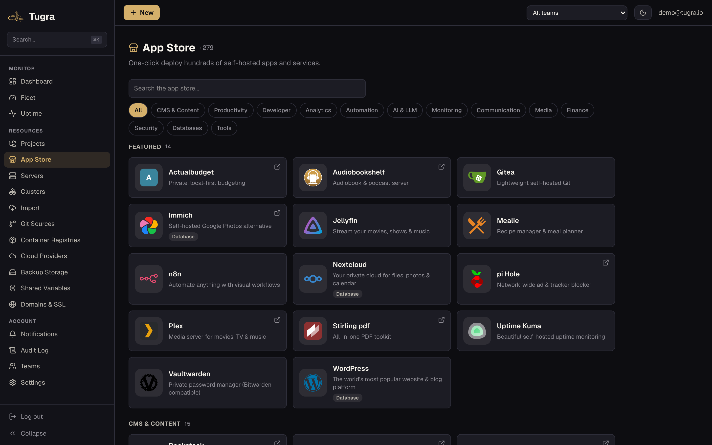
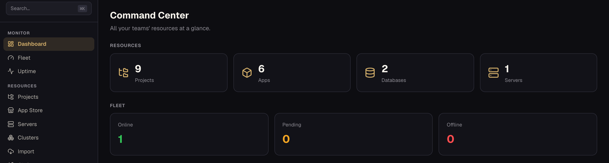
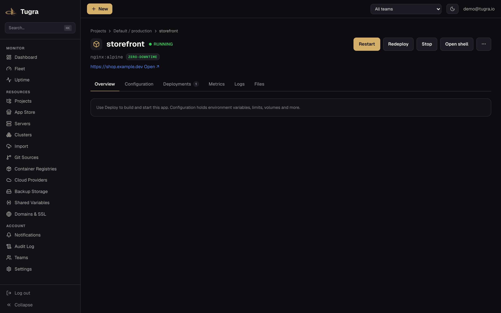
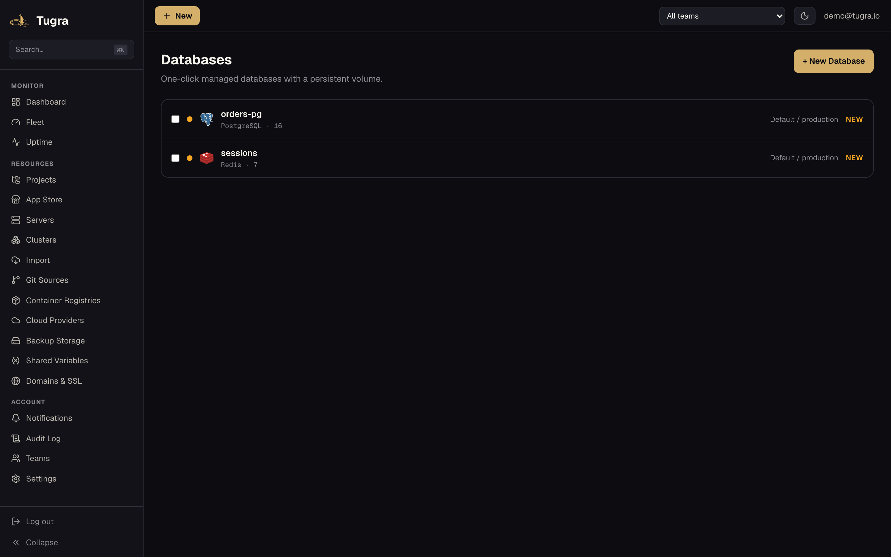
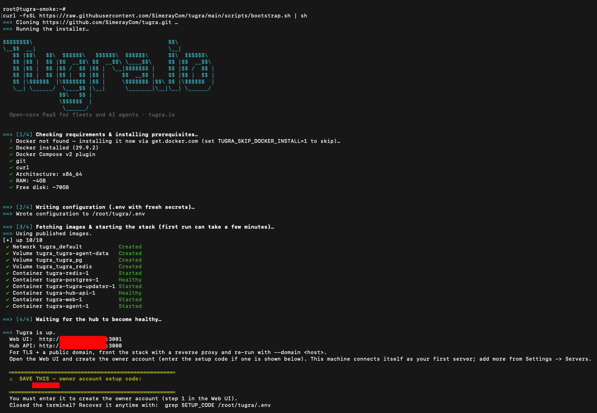

<div align="center">


# Tugra

*Ihr Siegel auf jedem Server.*

**Open-Core-PaaS zum Selbsthosten, gebaut für Flotten und KI-Agenten.**

[](https://github.com/SimerayCom/tugra/stargazers)
[](LICENSE)
[](https://github.com/SimerayCom/tugra/releases)
[](https://github.com/SimerayCom/tugra/actions/workflows/ci.yml)
[](#schnellstart)

[Website](https://tugra.io) · [Dokumentation](docs/README.md) · [Releases veröffentlichen](docs/RELEASING.md) · [Roadmap](#roadmap)

[ English](README.md) · [ Türkçe](README.tr.md) · [ Español](README.es.md) ·  **Deutsch** · [ Français](README.fr.md) · [ Português](README.pt.md) · [ 简体中文](README.zh.md) · [ 日本語](README.ja.md)

</div>

---

> **Status:** Beta. In aktiver Entwicklung; APIs können sich zwischen Minor-Releases ändern. Sterne, Issues und Feedback sind herzlich willkommen.

<div align="center">





&nbsp;

</div>

## Von Haus aus agentennativ

Tugra bringt einen nativen [MCP](https://modelcontextprotocol.io)-Server mit — richten Sie Claude, Cursor oder Ihren eigenen Agenten auf Ihre Infrastruktur, damit er sie einsehen, deployen, skalieren und betreiben kann, mit denselben Personal Access Tokens, Scopes und demselben Audit-Trail wie die REST API. Kein separates Integrationspaket, und dem Modell werden nie Secret-Werte zurückgegeben.

```bash
# List every tool the server exposes
curl -s https://your-tugra-host/api/v1/mcp \
  -H "Authorization: Bearer $TUGRA_PAT" \
  -H "Content-Type: application/json" \
  -d '{"jsonrpc":"2.0","id":1,"method":"tools/list"}'

# Ask it something real: what's actually deployed right now?
curl -s https://your-tugra-host/api/v1/mcp \
  -H "Authorization: Bearer $TUGRA_PAT" \
  -H "Content-Type: application/json" \
  -d '{"jsonrpc":"2.0","id":2,"method":"tools/call","params":{"name":"list_applications","arguments":{}}}'
```

Es ist derselbe `POST /api/v1/mcp`-Endpoint mit derselben Authentifizierung per Personal Access Token, denselben Scopes und derselben IP-Allowlist wie bei der darunterliegenden REST API — es gibt keine separaten Zugangsdaten zu verwalten, und entschlüsselte Secret-Werte werden dem Modell nie zurückgegeben. Der Katalog umfasst **48 Tools**: 26 rein lesende (darunter Flotten-Status-, Health- und App-Listen-Übersichten mit nur einem Aufruf sowie ein sandboxbasierter Datei-Browser für Volumes) plus 22 schreibende und Flotten-Tools mit PAT-Scope (deployen · einen Deploy in der Warteschlange abbrechen · neu starten · live skalieren · Rollback · Umgebungsvariablen setzen · einen Swarm bilden/erweitern · flottenweite Aktionen über einen Cluster · DNS-Einrichtung für Domains mit einem Klick). Jedes dieser Tools nutzt exakt dieselben Team-Berechtigungsprüfungen und denselben Audit-Trail wie die REST API, und unumkehrbare Aktionen (einen Swarm auflösen, eine App entfernen) erfordern eine ausdrückliche Bestätigung durch Eingabe des Namens. OAuth für Drittanbieter-Clients steht noch auf der Roadmap.

## Was ist Tugra?

Tugra ist eine selbst hostbare Open-Core-Control-Plane zum Deployen, Überwachen und Betreiben von Apps und Datenbanken auf Ihren eigenen Servern — das Tagesgeschäft von Heroku, Render oder Railway, ohne Ihre Infrastruktur in die Cloud eines Fremden zu geben. Der Schwerpunkt liegt auf der **Flotte**: echte Docker-Swarm-Cluster über Ihre Server hinweg (nicht bloß die Verwaltung einer Maschine nach der anderen), flottenweite Bulk-Operationen und ein integrierter MCP-Server für KI-gesteuerten Betrieb — alles unter einer Lizenz, die Sie tatsächlich lesen können.

## Warum Tugra

- **Flotte zuerst, nicht Einzelmaschine** — fassen Sie Server zu Clustern zusammen, bilden Sie darüber einen echten Docker Swarm und führen Sie mit einem einzigen Bulk-Operations-Aufruf einen Befehl auf Ihrer gesamten Flotte aus, statt sich per SSH auf jeder einzelnen Maschine einzuloggen.
- **Auch agentennativ** — ein integrierter MCP-Server stellt 48 Tools bereit (lesende sowie schreibende und Flotten-Tools mit PAT-Scope) über `POST /api/v1/mcp`, abgesichert durch dieselben Personal Access Tokens wie die REST API.
- **9 Datenbank-Engines, ein Workflow** — PostgreSQL, MySQL, MariaDB, MongoDB, Redis, KeyDB, Dragonfly, ClickHouse und LibSQL, alle auf dieselbe Weise bereitgestellt; acht davon haben integrierte logische Dump-/Restore-Backups (LibSQL, das kein Dump-Tool hat, wird durch die Volume-Backups abgedeckt).
- **Echtes TLS, echte Wildcards** — automatische Let's-Encrypt-Zertifikate pro App über Traefik, dazu DNS-01-Wildcard-Zertifikate (`*.yourdomain.com`) für Cluster-/Swarm-Ingress — nicht nur HTTP-01 für einzelne Domains.
- **Offsite-Backups** — geplante Dumps auf lokalen Speicher oder S3-kompatiblen Objektspeicher (S3/R2/MinIO), verschlüsselt, mit Restore per Klick.
- **Open-Core, nicht Open-Washing** — alles oben Genannte wird kostenlos unter AGPL-3.0 in *diesem* Repository ausgeliefert. Pro/Cloud (SSO, Audit-Log-Export, Whitelabel, mandantenfähige Abrechnung) ist ein separat lizenziertes Add-on — nichts hier drängt Sie zum Upgrade oder schränkt heimlich ein, was Sie tun können. Tugra sendet anonyme Nutzungsstatistiken, standardmäßig aktiviert — aggregierte Zähler (Server, Apps, Datenbanken, Deploys) plus Ihre Version, Edition und Ihr Betriebssystem, unter einer zufälligen ID; keine Namen, IPs, Domains oder Secrets, und der Empfänger speichert Ihre IP nicht — und Sie können sie jederzeit mit `--no-telemetry` / `TUGRA_TELEMETRY=0` oder in den Settings abschalten. Update-Checks und die Erkennung der öffentlichen IP sind Opt-in und standardmäßig deaktiviert.

## So schneidet Tugra im Vergleich ab

Ein direkter Vergleich mit den selbst hostbaren PaaS-Tools, die tatsächlich evaluiert werden (Konkurrenzdaten geprüft: 2026-10). `✅` integriert · `~` teilweise / eingeschränkt · `—` kein dokumentiertes integriertes Äquivalent · `🔜` auf Tugras Roadmap. Einen Fehler entdeckt? [Eröffnen Sie ein Issue](https://github.com/SimerayCom/tugra/issues).

| | **Tugra** | Coolify | Dokploy | Portainer | CapRover | Dokku |
|---|---|---|---|---|---|---|
| **Deployment & Build** | | | | | | |
| Web-UI-Dashboard | ✅ | ✅ | ✅ | ✅ | ✅ | — |
| Deployment aus Git | ✅ | ✅ | ✅ | ~ | ~ | ✅ |
| Docker-Compose-Deployment | ✅ | ✅ | ✅ | ✅ | ~ | ~ |
| Preview-Deployments (PR-Apps) | ✅ | ✅ | ✅ | — | — | ~ |
| Rollbacks | ✅ | ✅ | ✅ | — | ✅ | ~ |
| App Store / Ein-Klick-Vorlagen | ✅ | ✅ | ✅ | ✅ | ✅ | — |
| **Daten** | | | | | | |
| Verwaltete Datenbank-Engines | **9** | 8 | 6 | — | — | — |
| Geplante S3-Backups + Restore | ✅ | ✅ | ✅ | — | — | ~ |
| Docker-Volume-Backups für Apps | ✅ | — | ✅ | — | — | — |
| **Domains & TLS** | | | | | | |
| Eigene Domains + automatisches SSL | ✅ | ✅ | ✅ | — | ✅ | ✅ |
| DNS-01-Wildcard-Zertifikate | ✅ | ~ | — | — | — | ~ |
| **Flotte & HA** | | | | | | |
| Multi-Node-Clustering | ✅ Swarm | Einzeln¹ | ✅ Swarm | ✅ | ✅ | ~ k3s⁶ |
| Multi-Manager-Raft-HA + Ingress-HA | ✅ | — | — | — | — | — |
| Flottenweite Bulk-Operationen (ein Aufruf) | ✅ | — | — | — | — | — |
| OS-Patching (pro Server + Flotte) | ✅ | — | — | — | — | — |
| **Observability** | | | | | | |
| Integrierte Metriken (CPU/RAM/Disk) | ✅ | ~ | ✅ | ~ | — | — |
| Uptime-Monitore + Benachrichtigungen | ✅ | ~ | ✅ | — | — | — |
| App-/Container-Log-Viewer | ✅ | ✅ | ✅ | ✅ | — | ✅ |
| **Zugriff & Agent** | | | | | | |
| Teams / RBAC | ✅ | ~ | ✅ | ~⁷ | — | — |
| SSO / OIDC | ✅ (Pro)⁸ | ✅ | ✅ | ~⁷ | — | — |
| Audit-Log | ✅ | ✅ | ✅ | ~⁷ | — | — |
| MCP / Agentensteuerung | ✅ 48 Tools⁵ | ✅ | ✅ | — | — | ~² |
| **Vertrauen & Lizenz** | | | | | | |
| Telemetrie | Anonym, Opt-out (nur Zähler) | n/a | n/a | n/a | n/a | n/a |
| Migration zu Tugra (Import aus Coolify) | ✅⁹ | — | — | — | — | — |
| Kernlizenz | AGPL-3.0 | Apache-2.0 | Apache-2.0³ | zlib + BE⁷ | Apache-2.0 + Bedingungen⁴ | MIT |

<sub>¹ Coolify v4 verwaltet Server einzeln (kein integriertes Clustering). ² Ein MCP-Projekt eines Drittanbieters für Dokku im frühen Stadium, kein offizielles Release. ³ Der Kern von Dokploy steht unter Apache-2.0; eine separate Source-Available-Lizenz deckt das Enterprise-Verzeichnis `proprietary/` ab (SSO, Audit-Logs, Whitelabel) — dasselbe Open-Core-Modell, das auch Tugra verwendet. ⁴ Die `LICENSE` von CapRover ist Apache-2.0 mit einem Zusatz, der Änderung und Weiterverbreitung kostenpflichtiger Funktionen einschränkt. ⁵ Tugra, Coolify und Dokploy liefern alle MCP-Server mit Lese- und Schreib-Tools aus, die Agentensteuerung ist also gleichauf; Tugra ergänzt flottenweite Aktionen (ein Aufruf über einen Cluster), Namensbestätigung bei destruktiven Tools und Maskierung von Secrets. ⁶ Dokku unterstützt Docker Swarm nicht; seine Multi-Node-Option ist das Plugin `scheduler-k3s` (k3s/Kubernetes), eine andere Architektur. ⁷ RBAC, SSO und Audit-Logs von Portainer sind Teil der kostenpflichtigen Business Edition. ⁸ Tugras Kern ist kostenlos und voll funktionsfähig (Teams/RBAC, Audit-Log, Backups, Monitoring, MCP, Migrator, Multi-Node-HA); SSO/OIDC ist ein Pro-Feature. ⁹ Importiert Coolify-Apps samt Konfiguration/Env als neue Tugra-Ressourcen (Copy-Modus); ein separater Adopter für lokales Docker übernimmt Container auf demselben Host direkt an Ort und Stelle (unter Beibehaltung ihrer benannten Volumes). Die Datenbank-**Daten** von Postgres, MySQL, MariaDB, Redis, KeyDB und Dragonfly migrieren hostübergreifend mit einem Ein-Befehl-Migrator, den Sie auf dem Coolify-Host einfügen; MongoDB-Daten migrieren per geführtem Dump und Restore (import-from-url), LibSQL- und App-**Volume**-Daten per `tar`/`rsync`, und für ClickHouse gibt es noch kein Migrationstool ([docs/coolify-migration.md](docs/coolify-migration.md)). Produktnamen sind Marken ihrer jeweiligen Inhaber; Tugra steht in keiner Verbindung zu ihnen und wird von ihnen nicht befürwortet.</sub>

## Schnellstart

Auf einem frischen Linux-Host installiert **ein Befehl** die Voraussetzungen (git, Docker), klont das Repo und fährt den Stack hoch:

```bash
curl -fsSL https://raw.githubusercontent.com/SimerayCom/tugra/main/scripts/bootstrap.sh | sh
```

<p align="center"></p>

Möchten Sie ein Skript erst lesen, bevor Sie es ausführen (sinnvoll bei jedem Skript, dem Sie praktisch Root-Zugriff auf Docker geben)? Klonen Sie das Repo und führen Sie den Installer selbst aus — er schreibt nur eine lokale `.env`, ruft `docker compose` auf, installiert Docker, falls es fehlt, und ist idempotent (sicher wiederholbar):

```bash
git clone https://github.com/SimerayCom/tugra.git
cd tugra
less scripts/install.sh   # review it first
./scripts/install.sh
```

Der Installer erzeugt starke Secrets in einer lokalen `.env` (bei erneutem Ausführen bleiben sie erhalten) und startet dann Hub, Web-UI, PostgreSQL und Redis mit `docker compose`. Wenn er fertig ist, öffnen Sie die ausgegebene **Web-UI**-URL (`http://<host-ip>:3001`; die Hub-/API-Basis ist `http://<host-ip>:3000`) und legen Sie das erste Konto an — es wird zum **Owner** der Instanz. Bei einer frischen Installation gibt der Installer außerdem einen einmaligen **Setup-Code** aus, der beim Anlegen dieses Kontos einzugeben ist (mit `grep SETUP_CODE .env` finden Sie ihn wieder). Folgen Sie anschließend dem Onboarding-Assistenten, um Ihren ersten Server zu verbinden.

Das erneute Ausführen von `./scripts/install.sh` (z. B. nach `git pull`) ist unbedenklich — es behält Ihre Secrets und aktualisiert nur die Konfiguration, und dient somit zugleich als Upgrade-Pfad.

**Produktion (TLS + eine Domain).** Für einen schnellen Start läuft der Stack über unverschlüsseltes HTTP auf den Ports dieses Hosts; stellen Sie ihn hinter Ihren eigenen Reverse Proxy, der TLS terminiert, und führen Sie das Skript erneut mit Ihrer Domain aus:

```bash
./scripts/install.sh --domain tugra.example.com
```

Leiten Sie den Großteil des Traffics an die **Web**-UI (`:3001`) — sie reicht die REST API und den OAuth-Start für Sie an den Hub weiter — und schicken Sie nur die Pfade, die die Web-UI nicht verarbeiten kann, direkt an den **Hub** (`:3000`):

| Pfadpräfix | → |
|---|---|
| `/agent`, `/terminal` (WebSocket), `/install`, `/webhooks`, `/auth/oauth` | Hub `:3000` |
| alles andere (`/`, `/api/*`) | Web-UI `:3001` |

Hinweise:

- **TLS ist nicht enthalten** — bringen Sie Ihren eigenen Reverse Proxy mit (Caddy, Traefik, nginx, …). `--domain` setzt für dieses Setup `COOKIE_SECURE=true` + `HUB_TRUSTED_PROXY=true`.
- **Sichern Sie die Roh-Ports ab.** Mit `HUB_TRUSTED_PROXY=true` vertraut der Hub dem Header `X-Forwarded-For`, daher dürfen die Roh-Ports `:3000`/`:3001` **nur** den Proxy erreichen. Eine frische `--domain`-Installation bindet sie an `127.0.0.1` (Proxy auf demselben Host). Läuft der Proxy auf einem anderen Host, setzen Sie `HUB_BIND`/`WEB_BIND` auf die IP der privaten Netzwerkschnittstelle dieser Maschine und schützen Sie die Ports per Firewall — von Docker veröffentlichte Ports umgehen `ufw`.
- **„Sign in with GitHub“** funktioniert nur in diesem Single-Origin-Proxy-Deployment (Hub und Web-UI teilen sich einen öffentlichen Origin, damit das Session-Cookie für die SPA sichtbar ist); im einfachen Schnellstart mit zwei Ports ist es nicht verfügbar.

> Veröffentlichte Images (`ghcr.io/simeraycom/tugra-*`) erscheinen mit dem ersten getaggten Release. Bis dahin baut der Installer automatisch aus Ihrem Checkout — derselbe Befehl, keine Änderungen nötig.

**MCP-Schnellstart.** Sobald Tugra läuft, erzeugen Sie einen Personal Access Token (**Settings → API tokens**) und richten Sie einen beliebigen MCP-Client darauf:

```bash
curl -s http://<web-url>/api/v1/mcp \
  -H "Authorization: Bearer $TUGRA_PAT" -H "Content-Type: application/json" \
  -d '{"jsonrpc":"2.0","id":1,"method":"initialize"}'
```

## Selbst gehostet vs. Cloud

Alles unter [Warum Tugra](#warum-tugra) oben ist **für immer kostenlos und Open Source**, unter AGPL-3.0, selbst gehostet auf Ihren eigenen Servern — keine künstliche Obergrenze, kein Feature-Flag, das nur darauf wartet, gegen Bezahlung umgelegt zu werden. Die Community Edition in diesem Repository ist das echte Produkt, keine abgespeckte Demo.

Die Editionen Pro und Cloud (SSO, Audit-Log-Export, Whitelabel, verwaltete Control-Plane) werden unter einer separaten kommerziellen Lizenz angeboten. Wenn Sie eine Lizenz außerhalb der AGPL benötigen oder etwas, das die Community Edition nicht abdeckt, schreiben Sie an **license@tugra.io**.

## Architektur

| Komponente | Stack |
|---|---|
| Hub (API + Kommandozentrale) | NestJS · PostgreSQL (Prisma) · Redis / BullMQ |
| Web-UI | Next.js |
| Agent | Go (einzelnes Binary pro Server) |
| Proxy | Traefik (automatisches SSL, inkl. DNS-01-Wildcard) |

Live-Logs, Metriken und das Terminal werden per WebSocket gestreamt. Die vollständige Aufschlüsselung finden Sie in [docs/architecture.md](docs/architecture.md).

## Roadmap

**Ausgeliefert**

- [x] Hub ↔ Agent-Protokoll + Server-Enrollment (ausgehende WSS-Verbindung · ed25519 · signierte Befehle + Capability-Scope)
- [x] Deployment aus Git / Docker Compose / Image (Nixpacks · Dockerfile · statische Sites)
- [x] Reverse Proxy + automatisches SSL (Traefik · Let's Encrypt, inkl. DNS-01-Wildcard)
- [x] Live-Metriken, Build-Logs & Web-Terminal (WebSocket-Streams)
- [x] Datenbanken (9 Engines) mit Backups & Restore (lokal + S3/R2 offsite)
- [x] Multi-Server-Cluster + Aufbau von Docker Swarm, Bulk-Operationen über die Flotte
- [x] Nativer MCP-Server — 48 Tools (lesende sowie schreibende und Flotten-Tools mit PAT-Scope) + geführte Prompts
- [x] App Store — Ein-Klick-Vorlagenkatalog + Home-Mode-Launcher
- [x] Schreibgeschützter Datei-Browser für App-Volumes (Web-UI + MCP `list_files`)
- [x] Preview-Deployments (pro Pull Request)
- [x] Uptime-Monitoring (HTTP/TCP/Metrik) + Benachrichtigungskanäle
- [x] Geplante Aufgaben (Cron) · Rollbacks · Ressourcenlimits & Health-Checks
- [x] Projekte / Umgebungen · Teams, Rollen & Einladungen · Tags · gemeinsame Variablen
- [x] Öffentliche API (OpenAPI) + CLI (`tugra`)
- [x] Server-Patching (OS-Paket-Updates)
- [x] Self-Update (signierte Releases) + geführtes Onboarding
- [x] Migrator — lokale Docker-Container übernehmen + Import aus Coolify (verbinden · planen · anwenden · Rollback) + hostübergreifende Migration von DB-Daten mit einem Befehl (Postgres · MySQL · MariaDB · Redis · KeyDB · Dragonfly)

**Als Nächstes**

- [ ] MCP-OAuth für Drittanbieter-Clients (dynamische Client-Registrierung, PKCE)
- [ ] Dateimanager — Schreibzugriff (Hochladen / Umbenennen / Löschen)
- [ ] Ein-Klick-Migration für ClickHouse- und MongoDB-Daten sowie App-Volume-Daten
- [ ] Weitere Migrationsquellen (Dokploy, CapRover)
- [ ] Mobile App

## Community & Dokumentation

- [Vollständige Dokumentation](docs/README.md) — Installation, Architektur, API, CLI, Sicherheit, Open-Core
- [Issues](https://github.com/SimerayCom/tugra/issues) — Fehlerberichte & Feature-Wünsche
- [Discussions](https://github.com/SimerayCom/tugra/discussions) — Fragen, Ideen, Show-and-Tell
- [Mitwirken](CONTRIBUTING.md) · [Verhaltenskodex](CODE_OF_CONDUCT.md) · [CLA](CLA.md)
- [Sicherheitsrichtlinie](SECURITY.md)

## Mitwirkende

<a href="https://github.com/SimerayCom/tugra/graphs/contributors">
  
</a>

## Sponsoren

Tugra wird offen entwickelt und gepflegt. Wenn es Ihnen oder Ihrem Team nützt, freuen wir uns über ein [Sponsoring des Projekts auf GitHub](https://github.com/sponsors/mrcandev) — es gibt noch keine Sponsoren-Stufe, Sie wären also der Erste, und jeder Beitrag hilft, die Entwicklung unabhängig zu halten.

## Star-Verlauf

[](https://star-history.com/#SimerayCom/tugra&Date)

## Lizenz

Tugra verwendet ein **Open-Core**-Modell:

- **Core** (dieses Repository) — [GNU AGPLv3](LICENSE). Frei nutzbar, selbst hostbar, einsehbar und veränderbar. Wenn Sie eine modifizierte Version als Netzwerkdienst betreiben, müssen Sie Ihre Änderungen unter derselben Lizenz teilen.
- **Agent & CLI** — [MIT](agent/LICENSE). Überall einsetzbar, ohne Auflagen.
- **Tugra Cloud & Pro-Features** — proprietär, noch nicht veröffentlicht (siehe [Selbst gehostet vs. Cloud](#selbst-gehostet-vs-cloud)).

**Kommerzielle Lizenz:** Wenn Sie die AGPLv3 nicht einhalten können (z. B. weil Sie ein proprietäres Produkt oder ein SaaS-Angebot auf Basis von Tugra aufbauen möchten), ist eine kommerzielle Lizenz erhältlich. Kontaktieren Sie **license@tugra.io**. Die vollständige Aufschlüsselung finden Sie in [docs/open-core.md](docs/open-core.md).

---

<div align="center"><sub>AGPL-3.0 © Simeray Ltd — siehe <a href="LICENSE">LICENSE</a>.</sub></div>
