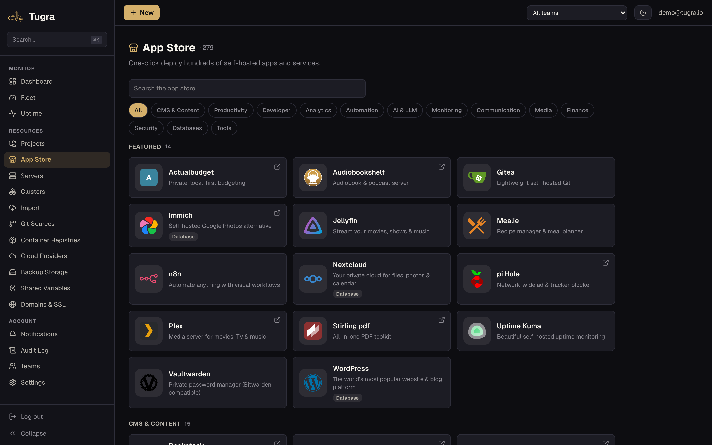
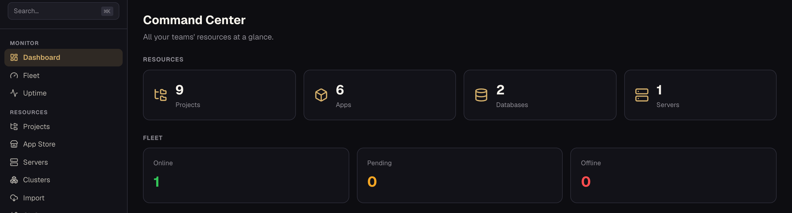
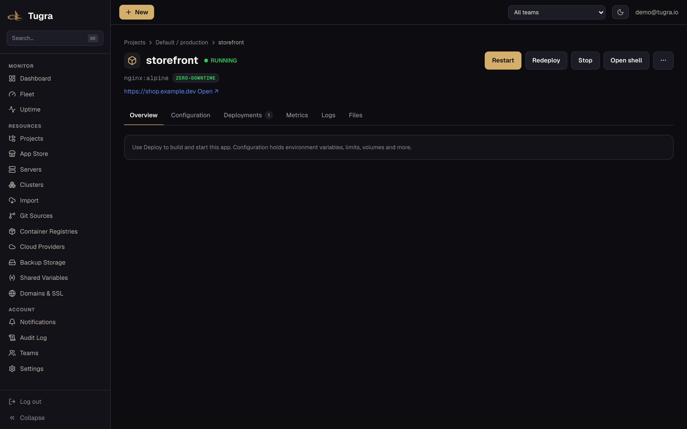
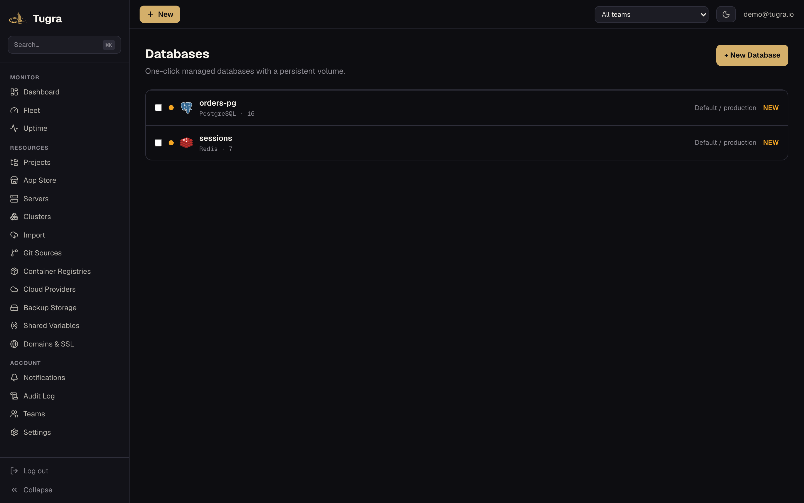
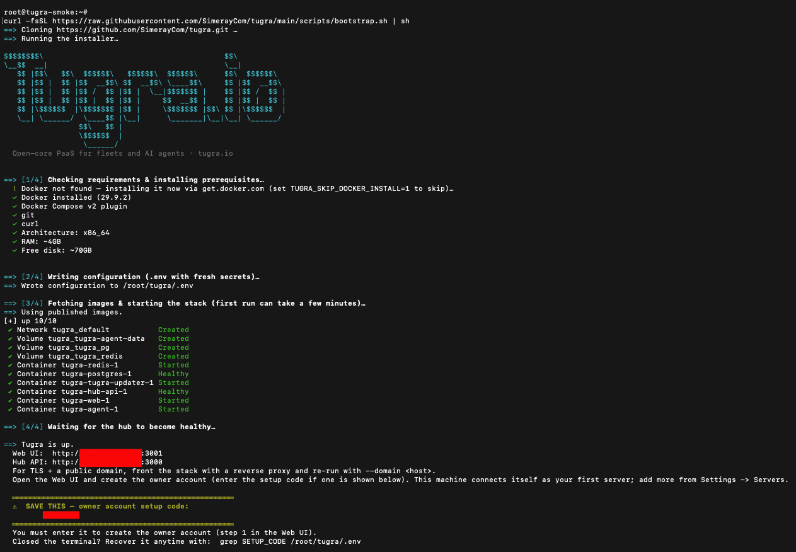

<div align="center">


# Tugra

*Ihr Siegel auf jedem Server.*

**Open-Core-PaaS zum Selbsthosten, gebaut für Flotten und KI-Agenten.**

[](https://github.com/SimerayCom/tugra/stargazers)
[](LICENSE)
[](https://github.com/SimerayCom/tugra/releases)
[](https://github.com/SimerayCom/tugra/actions/workflows/ci.yml)
[](#schnellstart)

[Website](https://tugra.io) · [Dokumentation](docs/README.md) · [Releases veröffentlichen](docs/RELEASING.md) · [Roadmap](#roadmap)

[ English](README.md) · [ Türkçe](README.tr.md) · [ Español](README.es.md) ·  **Deutsch** · [ Français](README.fr.md) · [ Português](README.pt.md) · [ 简体中文](README.zh.md) · [ 日本語](README.ja.md)

</div>

---

> Issues und Feedback sind willkommen. Was Sie ausprobieren können und wie Sie Fehler melden, steht im [Testleitfaden](docs/beta-testing.md).

<div align="center">





&nbsp;

</div>

## Von Haus aus agentennativ

Tugra bringt einen nativen [MCP](https://modelcontextprotocol.io)-Server mit — richten Sie Claude, Cursor oder Ihren eigenen Agenten auf Ihre Infrastruktur, damit er sie einsehen, deployen, skalieren und betreiben kann, mit denselben Personal Access Tokens, Scopes und demselben Audit-Trail wie die REST API. Kein separates Integrationspaket, und dem Modell werden nie Secret-Werte zurückgegeben.

```bash
# List every tool the server exposes
curl -s https://your-tugra-host/api/v1/mcp \
  -H "Authorization: Bearer $TUGRA_PAT" \
  -H "Content-Type: application/json" \
  -d '{"jsonrpc":"2.0","id":1,"method":"tools/list"}'

# Ask it something real: what's actually deployed right now?
curl -s https://your-tugra-host/api/v1/mcp \
  -H "Authorization: Bearer $TUGRA_PAT" \
  -H "Content-Type: application/json" \
  -d '{"jsonrpc":"2.0","id":2,"method":"tools/call","params":{"name":"list_applications","arguments":{}}}'
```

Es ist derselbe `POST /api/v1/mcp`-Endpunkt, dieselbe Authentifizierung per Personal Access Token, dieselben Scopes und dieselbe IP-Allowlist wie bei der darunterliegenden REST-API — keine separaten Zugangsdaten, und es werden nie entschlüsselte Secret-Werte an das Modell zurückgegeben. Der Katalog umfasst **82 Tools**: 45 nur lesende (darunter Fleet-Status, Health- und App-Listen-Übersichten in einem Aufruf sowie ein Datei-Browser für Volumes in einer Sandbox) plus 37 PAT-gescopte Mutate-/Ops-Tools (Deploy · einen wartenden Deploy abbrechen · Neustart · Live-Skalierung · Rollback · Env setzen · einen Server neu starten (Bestätigung per Tippen, danach verifiziert) · einen Cloud-Server beim Anbieter ein- und ausschalten, auch bei offline Agent (Bestätigung per Tippen) · Swarm bilden/erweitern · flottenweite Aktionen über einen Cluster · DNS-Einrichtung einer Domain mit einem Klick · der geführte Migrationslauf, standardmäßig als Dry-Run). Jedes Mutate-Tool nutzt exakt dieselben Team-Berechtigungsprüfungen und denselben Audit-Trail wie die REST-API, und die unumkehrbaren (Swarm auflösen, App entfernen) verlangen eine ausdrückliche Namensbestätigung. OAuth für Drittanbieter-Clients steht noch auf der Roadmap.

## Was ist Tugra?

Tugra ist eine selbst hostbare Open-Core-Control-Plane zum Deployen, Überwachen und Betreiben von Apps und Datenbanken auf Ihren eigenen Servern — das Tagesgeschäft von Heroku, Render oder Railway, ohne Ihre Infrastruktur in die Cloud eines Fremden zu geben. Der Schwerpunkt liegt auf der **Flotte**: echte Docker-Swarm-Cluster über Ihre Server hinweg (nicht bloß die Verwaltung einer Maschine nach der anderen), flottenweite Bulk-Operationen und ein integrierter MCP-Server für KI-gesteuerten Betrieb — alles unter einer Lizenz, die Sie tatsächlich lesen können.

## Warum Tugra

- **Flotte zuerst, nicht Einzelmaschine** — fassen Sie Server zu Clustern zusammen, bilden Sie darüber einen echten Docker Swarm und führen Sie mit einem einzigen Bulk-Operations-Aufruf einen Befehl auf Ihrer gesamten Flotte aus, statt sich per SSH auf jeder einzelnen Maschine einzuloggen.
- **Auch agentennativ** — ein integrierter MCP-Server stellt 82 Tools bereit (lesende sowie schreibende und Flotten-Tools mit PAT-Scope) über `POST /api/v1/mcp`, abgesichert durch dieselben Personal Access Tokens wie die REST API.
- **9 Datenbank-Engines, ein Workflow** — PostgreSQL, MySQL, MariaDB, MongoDB, Redis, KeyDB, Dragonfly, ClickHouse und LibSQL, alle auf dieselbe Weise bereitgestellt; acht davon haben integrierte logische Dump-/Restore-Backups (LibSQL, das kein Dump-Tool hat, wird nur durch dateibasierte Volume-Backups abgedeckt — stoppen Sie die App zuvor, um eine konsistente Kopie zu erhalten).
- **Echtes TLS, echte Wildcards** — automatische Let's-Encrypt-Zertifikate pro App über Traefik, dazu DNS-01-Wildcard-Zertifikate (`*.yourdomain.com`) für Cluster-/Swarm-Ingress — nicht nur HTTP-01 für einzelne Domains.
- **Offsite-Backups** — geplante Dumps auf lokalen Speicher oder S3-kompatiblen Objektspeicher (S3/R2/MinIO), optional verschlüsselt (gpg AES-256), mit Restore per Klick; geplante **Restore-Verify-Übungen** belegen, dass sich ein Backup tatsächlich wiederherstellen lässt, und PostgreSQL bietet **Point-in-Time-Recovery** (WAL-Shipping + Base-Backups, Restore auf jede beliebige Sekunde direkt im Panel).
- **Deploys, denen Sie vertrauen können** — Rolling Deploys mit Health Gate und automatischem Rollback bei fehlgeschlagenem Gate (plus eine optionale Soak-Phase nach dem Cutover, die bei Problemen automatisch zurückrollt), Flotten-Rollouts (Canary → Wellen → Halt/Rollback), Build-Secrets, die nie im Image landen, und Deploys, die einen Neustart der Control Plane überstehen.
- **Coolify aus dem Panel verlassen** — fügen Sie den Server hinzu, auf dem Coolify läuft, und gehen Sie dann zu **Import > Coolify > Connect through the agent**. Tugra liest die eigene Datenbank von Coolify über den Agent (kein API-Token), ordnet die Server von Coolify Ihren Servern anhand von Belegen zu und übernimmt jeden Server an Ort und Stelle, mit den Images, die Coolify gebaut hat, und den Volumes, die es schon nutzt. Danach räumen Sie auf, was Coolify hinterlassen hat (Daten-Volumes bleiben unangetastet), verschieben ganze Projekte mit Rollback zwischen Servern und fahren Coolify herunter. „Give back to Coolify“ macht eine Übernahme bis zum Aufräumen mit einem Klick rückgängig. Siehe [Move off Coolify](docs/move-off-coolify.md).
- **Open-Core, nicht Open-Washing** — alles oben Genannte wird kostenlos unter AGPL-3.0 in *diesem* Repository ausgeliefert. Pro/Cloud-Funktionen (SSO, Audit-Log-Export, Whitelabel) werden mit einem separat lizenzierten, signierten Schlüssel freigeschaltet — nichts hier drängt Sie zum Upgrade oder schränkt heimlich ein, was Sie tun können. Tugra sendet anonyme Nutzungsstatistiken, standardmäßig aktiviert — aggregierte Zähler (Server, Apps, Datenbanken, Deploys, Teams, Nutzer, Cluster, Monitore) plus Ihre Version, Release-Kanal, Edition, Ihr Betriebssystem, die CPU-Architektur und die Node.js-Hauptversion, unter einer zufälligen ID; keine Namen, IPs, Domains oder Secrets, und der Empfänger speichert Ihre IP nicht — und Sie können sie jederzeit mit `--no-stats` / `TUGRA_STATS=0` oder in den Settings abschalten. Update-Checks sind ebenfalls standardmäßig aktiv — ein signierter Manifest-Abruf von ca. 2 KB pro Stunde, ohne Kennungen; abschalten mit `--no-update-checks` / `TUGRA_UPDATE_CHECKS=0`. Die Erkennung der öffentlichen IP bleibt Opt-in.

## So schneidet Tugra im Vergleich ab

Ein direkter Vergleich mit den selbst hostbaren PaaS-Tools, die tatsächlich evaluiert werden (Konkurrenzdaten geprüft: 2026-11). `✅` integriert · `~` teilweise / eingeschränkt · `—` kein dokumentiertes integriertes Äquivalent · `🔜` auf Tugras Roadmap. Einen Fehler entdeckt? [Eröffnen Sie ein Issue](https://github.com/SimerayCom/tugra/issues).

| | **Tugra** | Coolify | Dokploy | Portainer | CapRover | Dokku |
|---|---|---|---|---|---|---|
| **Deployment & Build** | | | | | | |
| Web-UI-Dashboard | ✅ | ✅ | ✅ | ✅ | ✅ | — |
| Deployment aus Git | ✅ | ✅ | ✅ | ~ | ~ | ✅ |
| Docker-Compose-Deployment | ✅ | ✅ | ✅ | ✅ | ~ | ~ |
| Preview-Deployments (PR-Apps) | ✅¹¹ | ✅ | ✅ | — | — | ~ |
| Rollbacks | ✅ | ✅ | ✅ | ~¹² | ✅ | ~ |
| App Store / Ein-Klick-Vorlagen | ✅ | ✅ | ✅ | ✅ | ✅ | — |
| **Daten** | | | | | | |
| Verwaltete Datenbank-Engines | **9** | 9 (SQLite experimentell)¹² | 6 | — | — | ~¹² |
| Geplante S3-Backups + Restore | ✅ | ✅ | ✅ | — | — | ~ |
| Docker-Volume-Backups für Apps (dateibasiert, kein Snapshot) | ✅ | ~¹² | ✅ | — | — | — |
| **Domains & TLS** | | | | | | |
| Eigene Domains + automatisches SSL | ✅ | ✅ | ✅ | — | ✅ | ✅ |
| DNS-01-Wildcard-Zertifikate | ✅ | ~ | — | — | ~¹² | ~ |
| **Flotte & HA** | | | | | | |
| Multi-Node-Clustering | ✅ Swarm | Einzeln¹ | ✅ Swarm | ✅ | ✅ | ~ k3s⁶ |
| Multi-Manager-Raft-HA + Ingress-HA | ✅ | — | — | — | — | — |
| Flottenweite Bulk-Operationen (ein Aufruf) | ✅ | — | — | — | — | — |
| OS-Patching (pro Server + Flotte) | ✅ | ~¹² | — | — | — | — |
| Point-in-Time-Recovery (PostgreSQL-WAL) | ✅¹⁰ | — | — | — | — | — |
| Geplante Restore-Verify-Übungen | ✅ | — | — | — | — | — |
| Flotten-Rollouts (Canary → Wellen → automatischer Halt/Rollback) | ✅ | — | — | ~¹² | — | — |
| Automatisches Rollback nach dem Cutover (Soak-Fenster, Opt-in pro App) | ✅ | — | ~¹² | — | — | — |
| **Observability** | | | | | | |
| Integrierte Metriken (CPU/RAM/Disk) | ✅ | ~ | ✅ | ~ | ~¹² | — |
| Uptime-Monitore + Benachrichtigungen | ✅ | ~ | ~¹² | — | — | — |
| App-/Container-Log-Viewer | ✅ | ✅ | ✅ | ✅ | ✅ | ✅ |
| **Zugriff & Agent** | | | | | | |
| Teams / RBAC | ✅ | ✅ | ✅ | ~⁷ | — | — |
| SSO / OIDC | ✅ (Pro)⁸ | ✅ | ✅ | ~⁷ | — | — |
| Audit-Log | ✅ | ✅ | ✅ | ~⁷ | — | — |
| MCP / Agentensteuerung | ✅ 82 tools⁵ | ✅ | ✅ | ~⁷ | — | ~² |
| **Vertrauen & Lizenz** | | | | | | |
| Nutzungsstatistik | Anonym, Opt-out (nur Zähler) | n/a | n/a | n/a | n/a | n/a |
| Migration zu Tugra (Import aus Coolify) | ✅⁹ | — | — | — | — | — |
| Kernlizenz | AGPL-3.0 | Apache-2.0 | Apache-2.0³ | zlib + BE⁷ | Apache-2.0 + Bedingungen⁴ | MIT |

<sub>¹ Coolify v4 verwaltet Server einzeln (kein integriertes Clustering); seine Docker-Swarm-Unterstützung ist veraltet (Entfernung in v5 geplant), und das Deployen eines Images auf mehrere Server erfordert einen eigenen Load Balancer. ² Ein MCP-Projekt eines Drittanbieters für Dokku im frühen Stadium, kein offizielles Release. ³ Der Kern von Dokploy steht unter Apache-2.0; eine separate Source-Available-Lizenz deckt das Enterprise-Verzeichnis `proprietary/` ab (SSO, Audit-Logs, Whitelabel) — dasselbe Open-Core-Modell, das auch Tugra verwendet. ⁴ Die `LICENSE` von CapRover ist Apache-2.0 mit einem Zusatz, der Änderung und Weiterverbreitung kostenpflichtiger Funktionen einschränkt. ⁵ Tugra, Coolify und Dokploy liefern alle MCP-Server mit Lese- und Schreib-Tools aus. Tugra ergänzt flottenweite Aktionen (ein Aufruf über einen Cluster), Namensbestätigung bei destruktiven Tools und Maskierung von Secrets. ⁶ Dokku unterstützt Docker Swarm nicht; seine Multi-Node-Option ist das Plugin `scheduler-k3s` (k3s/Kubernetes), eine andere Architektur. ⁷ Portainers vollständiges RBAC, AD/OIDC-SSO-Vorlagen und Audit-Logs gehören zur Business Edition (bis 3 Nodes kostenlos); die Community Edition bietet einfache Benutzer und eingeschränktes LDAP/OAuth. Das offizielle MCP-Server-Repository wird nicht unterstützt; der unterstützte KI-Weg (Portainer Command) gehört zur Business Edition. ⁸ Tugras Kern ist kostenlos und voll funktionsfähig (Teams/RBAC, Audit-Log, Backups, Monitoring, MCP, Migrator, Multi-Node-HA); SSO/OIDC ist ein Pro-Feature. ⁹ Liest Coolify über den Tugra-Agent auf dessen Server (kein API-Token) oder über die Coolify-API und übernimmt dann jeden Server an Ort und Stelle oder kopiert ihn auf einen anderen Server; ein separater Adopter für lokales Docker übernimmt außerdem Container auf demselben Host direkt (unter Beibehaltung ihrer benannten Volumes). Die Datenbank-**Daten** von Postgres, MySQL, MariaDB, MongoDB, ClickHouse, Redis, KeyDB und Dragonfly migrieren hostübergreifend mit einem Ein-Befehl-Migrator, den Sie auf dem Coolify-Host einfügen, App-**Volume**-Daten per gestreamter, fortsetzbarer Volume-Kopie des Migrators, LibSQL per `tar`/`rsync` ([docs/move-off-coolify.md](docs/move-off-coolify.md), [docs/coolify-migration.md](docs/coolify-migration.md)). ¹⁰ Nur PostgreSQL; andere Engines behalten geplante logische Dumps. ¹¹ Pull-/Merge-Request-Events von GitHub, GitLab, Gitea/Forgejo und Bitbucket (Cloud und Server) erstellen, aktualisieren und entfernen Previews; Previews brauchen eine per Git gebaute App mit aktivierten Previews, Pull Requests aus Forks werden ignoriert. ¹² Konkurrenzhinweise aus den offiziellen Dokumentationen, 2026-11: Coolify Server Patching gilt pro Server und ist Beta, seine Storage-Backups haben keinen Restore über die UI, und es dokumentiert 9 DB-Engines, aber geplante Backups nur für 6; Dokploys Monitoring-Schwellenwerte sind als nur Cloud gekennzeichnet, und sein Rollback ist das Docker-Swarm-native Update-Rollback, das Sie selbst konfigurieren; Portainers Canary-artiges Gruppen-Rollout gehört zur Business Edition und gilt nur für Edge Stacks; CapRovers DNS-01 und Netdata-Monitoring sind manuelle/Opt-in-Setups; Dokkus Datenbank-Engines sind offizielle CLI-Plugins ohne UI. Produktnamen sind Marken ihrer jeweiligen Inhaber; Tugra steht in keiner Verbindung zu ihnen und wird von ihnen nicht befürwortet.</sub>

## Schnellstart

Auf einem frischen Linux-Host installiert **ein einziger Befehl** die Voraussetzungen (git, Docker), klont das Repository und startet den Stack. Keine Domain, kein Cloudflare-Token, keine weitere Einrichtung — das Panel läuft danach unter `http://<server-ip>/` (Port 80, ausgeliefert vom eigenen Proxy von Tugra, es müssen also nur die Ports 80/443 offen sein):

```bash
curl -fsSL https://tugra.io/install | sh
```

Öffnen Sie anschließend die ausgegebene URL, legen Sie das Owner-Konto an und tragen Sie — sobald Sie eine Domain haben — unter **Settings → Instance → Panel domain** ein (kostenloses HTTPS von Let's Encrypt, kein Token nötig, funktioniert auch hinter der orangen Wolke von Cloudflare). Wenn Sie die Domain von der ersten Minute an nutzen wollen, richten Sie deren DNS auf den Server und hängen Sie sie an denselben Befehl an:

```bash
curl -fsSL https://tugra.io/install | sh -s -- --domain panel.example.com
```

<p align="center"></p>

Möchten Sie ein Skript erst lesen, bevor Sie es ausführen (sinnvoll bei jedem Skript, dem Sie praktisch Root-Zugriff auf Docker geben)? Klonen Sie das Repo und führen Sie den Installer selbst aus — er schreibt nur eine lokale `.env`, ruft `docker compose` auf, installiert Docker, falls es fehlt, und ist idempotent (sicher wiederholbar):

```bash
git clone https://github.com/SimerayCom/tugra.git
cd tugra
less scripts/install.sh   # review it first
./scripts/install.sh
```

Der Installer erzeugt starke Secrets in einer lokalen `.env` (bei erneutem Ausführen bleiben sie erhalten) und startet dann Hub, Web-UI, PostgreSQL und Redis mit `docker compose`. Wenn er fertig ist, öffnen Sie die ausgegebene **Web-UI**-URL (`http://<host-ip>/`, bzw. `https://<your-domain>` mit `--domain`) und legen Sie das erste Konto an — es wird zum **Owner** der Instanz. Bei einer frischen Installation gibt der Installer außerdem einen einmaligen **Setup-Code** aus, der beim Anlegen dieses Kontos einzugeben ist (mit `grep SETUP_CODE .env` finden Sie ihn wieder). Folgen Sie anschließend dem Onboarding-Assistenten, um Ihren ersten Server zu verbinden.

Das erneute Ausführen von `./scripts/install.sh` (z. B. nach `git pull`) ist unbedenklich — es behält Ihre Secrets und aktualisiert nur die Konfiguration, und dient somit zugleich als Upgrade-Pfad.

**Produktion (TLS + Domain).** `--domain` lässt Tugras eigenen Proxy das Panel per HTTPS mit einem automatischen Let's-Encrypt-Zertifikat ausliefern (HTTP-01; weder E-Mail noch Cloudflare-Token nötig). Richten Sie zuvor das DNS der Domain auf den Server. Oder lassen Sie das Flag weg und setzen Sie die Domain später unter **Settings → Instance → Panel domain**: Die alte Adresse funktioniert weiter, bis das Zertifikat ausgestellt ist, und die Änderung wird zurückgerollt, falls es scheitert. Wenn Sie Tugra stattdessen hinter Ihren **eigenen** Reverse Proxy stellen wollen, verwenden Sie `--no-auto-tls` (wird auch automatisch gewählt, wenn ein anderer Dienst :80/:443 schon belegt) und routen Sie wie unten beschrieben:

```bash
./scripts/install.sh --domain tugra.example.com --no-auto-tls
```

Leiten Sie den Großteil des Traffics an die **Web**-UI (`:3001`) — sie reicht die REST API und den OAuth-Start für Sie an den Hub weiter — und schicken Sie nur die Pfade, die die Web-UI nicht verarbeiten kann, direkt an den **Hub** (`:3000`):

| Pfadpräfix | → |
|---|---|
| `/agent`, `/terminal` (WebSocket), `/install`, `/webhooks`, `/auth/oauth` | Hub `:3000` |
| alles andere (`/`, `/api/*`) | Web-UI `:3001` |

Hinweise:

- **TLS:** mit `--domain` standardmäßig automatisch (mitgeliefertes Traefik + Let's Encrypt; `--acme-email you@domain` ist ein optionaler Kontakt für Ablaufhinweise) oder bringen Sie mit `--no-auto-tls` Ihren eigenen Reverse Proxy mit (Caddy, Traefik, nginx, …). Hinter der orangen Cloudflare-Wolke funktioniert es ohne Token; stellt sich das erste Zertifikat nicht aus, setzen Sie den SSL/TLS-Modus auf **Full** und schalten Sie **Always Use HTTPS** aus, bis es klappt (ein DNS-01-Token über `--acme-dns-cloudflare-file` ist eine optionale Alternative). `--domain` setzt `COOKIE_SECURE=true` + `HUB_TRUSTED_PROXY=true`.
- **Klassischer Zwei-Port-Schnellstart.** `--raw-ports` behält das alte Layout bei (kein Proxy; Web `:3001`, Hub `:3000`); das behält auch eine Installation, die vor dieser Änderung gemacht wurde, und das bekommt ein Host, auf dem Port 80 schon belegt ist.
- **Sichern Sie die Roh-Ports ab.** Mit `HUB_TRUSTED_PROXY=true` vertraut der Hub dem Header `X-Forwarded-For` (nur von privaten, Loopback- oder Docker-Peers oder aus `HUB_TRUSTED_PROXY_CIDRS`), und die Roh-Ports `:3000`/`:3001` sollten **nur** den Proxy erreichen. Eine frische `--domain`-Installation bindet sie an `127.0.0.1` (Proxy auf demselben Host); auch eine bestehende Installation, die auf https umgestellt wird, wird dorthin verschoben (`--keep-raw-ports` verzichtet darauf). Läuft der Proxy auf einem anderen Host, setzen Sie `HUB_BIND`/`WEB_BIND` auf die IP der privaten Netzwerkschnittstelle dieser Maschine und schützen Sie die Ports per Firewall — von Docker veröffentlichte Ports umgehen `ufw`.
- **„Sign in with GitHub“** funktioniert nur in diesem Single-Origin-Proxy-Deployment (Hub und Web-UI teilen sich einen öffentlichen Origin, damit das Session-Cookie für die SPA sichtbar ist); im einfachen Schnellstart mit zwei Ports ist es nicht verfügbar.

> Veröffentlichte Images (`ghcr.io/simeraycom/tugra-*`) werden automatisch gepullt; auf einem Host ohne veröffentlichtes Image für seine Architektur baut der Installer aus Ihrem Checkout — derselbe Befehl, keine Änderungen nötig. Jedes Release ist per Digest gepinnt und wird mit signierter Provenance ausgeliefert; siehe [docs/upgrade.md](docs/upgrade.md).

**MCP-Schnellstart.** Sobald Tugra läuft, erzeugen Sie einen Personal Access Token (**Settings → API tokens**) und richten Sie einen beliebigen MCP-Client darauf:

```bash
curl -s http://<web-url>/api/v1/mcp \
  -H "Authorization: Bearer $TUGRA_PAT" -H "Content-Type: application/json" \
  -d '{"jsonrpc":"2.0","id":1,"method":"initialize"}'
```

## Selbst gehostet vs. Cloud

Alles unter [Warum Tugra](#warum-tugra) oben ist **für immer kostenlos und Open Source**, unter AGPL-3.0, selbst gehostet auf Ihren eigenen Servern — keine künstliche Obergrenze, kein Feature-Flag, das nur darauf wartet, gegen Bezahlung umgelegt zu werden. Die Community Edition in diesem Repository ist das echte Produkt, keine abgespeckte Demo.

Die Editionen Pro und Cloud (SSO, Audit-Log-Export, Whitelabel, verwaltete Control-Plane) werden unter einer separaten kommerziellen Lizenz angeboten. Wenn Sie eine Lizenz außerhalb der AGPL benötigen oder etwas, das die Community Edition nicht abdeckt, schreiben Sie an **license@tugra.io**.

## Architektur

| Komponente | Stack |
|---|---|
| Hub (API + Kommandozentrale) | NestJS · PostgreSQL (Prisma) · Redis / BullMQ |
| Web-UI | Next.js |
| Agent | Go (einzelnes Binary pro Server) |
| Proxy | Traefik (automatisches SSL, inkl. DNS-01-Wildcard) |

Live-Logs, Metriken und das Terminal werden per WebSocket gestreamt. Die vollständige Aufschlüsselung finden Sie in [docs/architecture.md](docs/architecture.md).

## Roadmap

**Ausgeliefert** (bis v0.1.0-beta.33)

- [x] Hub ↔ Agent-Protokoll + Server-Enrollment (ausgehende WSS-Verbindung · ed25519 · signierte Befehle + Capability-Scope)
- [x] Deployment aus Git / Docker Compose / Image (Nixpacks · Railpack · Heroku-Buildpacks · Dockerfile · statische Sites)
- [x] Reverse Proxy + automatisches SSL (Traefik · Let's Encrypt, inkl. DNS-01-Wildcard)
- [x] Live-Metriken, Build-Logs & Web-Terminal (WebSocket-Streams; das Terminal ist per Capability abgesichert und standardmäßig deaktiviert)
- [x] Datenbanken (9 Engines) mit Backups & Restore (lokal + S3/R2 offsite)
- [x] Multi-Server-Cluster + Aufbau von Docker Swarm, Bulk-Operationen über die Flotte
- [x] Nativer MCP-Server — 82 Tools (lesende sowie schreibende und Flotten-Tools mit PAT-Scope) + geführte Prompts
- [x] App Store — 280+ Ein-Klick-Vorlagen + Home-Mode-Launcher
- [x] Dateimanager für App-Volumes — durchsuchen, herunterladen, hochladen, bearbeiten, umbenennen, Berechtigungen ändern und löschen (Schreibzugriff ist eine optionale Server-Capability; Web-UI, dazu MCP `list_files` zum Lesen)
- [x] Preview-Deployments (pro Pull Request)
- [x] Uptime-Monitoring (HTTP/TCP/Metrik) + 12 Benachrichtigungskanäle (Webhook · Telegram · ntfy · Discord · Slack · Gotify · SMTP · Pushover · Teams · Mattermost · Lark · Resend)
- [x] Geplante Aufgaben (Cron) · Rollbacks · Ressourcenlimits & Health-Checks
- [x] Projekte / Umgebungen · Teams, Rollen & Einladungen · Tags · gemeinsame Variablen
- [x] Öffentliche API (OpenAPI) + CLI (`tugra`)
- [x] Server-Patching (OS-Paket-Updates), auf dem Host als transiente systemd-Unit ausgeführt, sodass ein Docker-/containerd-Upgrade es nicht auf halbem Weg abbricht; die gestaffelten (phased) Updates von Ubuntu werden getrennt aufgeführt · Docker-Bereinigung wie bei Coolify (täglich und zusätzlich, sobald die Platte eines Servers ihren Schwellenwert überschreitet; was gelöscht wird und was nie, zeigt die Serverseite)
- [x] Server über das Panel neu starten (sofort oder bis zu 7 Tage im Voraus geplant) mit Auswirkungsvorschau, danach automatische Prüfung, dass Docker, jeder zuvor laufende Container, jede geroutete Domain und das Reboot-Required-Flag wieder da sind; nur manuell, auch in CLI und MCP
- [x] Self-Update (signierte Releases) + geführtes Onboarding
- [x] Migrator — lokale Docker-Container übernehmen + Import aus Coolify (Web-Assistent, über den Tugra-Agent oder die API) und Dokploy (Web-Assistent / API / MCP / CLI) (verbinden · planen · anwenden · Rollback) + hostübergreifende Migration von DB-Daten mit einem Befehl (Postgres · MySQL · MariaDB · Redis · KeyDB · Dragonfly) + gestreamtes, fortsetzbares Kopieren von App-Volumes + ein geführter, fortsetzbarer Migrationslauf (`tugra import run` und die `migration_run_*`-MCP-Tools: zuerst Dry-Run, getippte Freigaben, Abbruch/Rückgängig) mit einem gestreamten Dump-Pfad für große Datenbanken (Postgres · MySQL · MariaDB) — gegen Coolify 4.1.2 und 4.7.5 geprüft (API-Ratenlimits, Container-Namen mit Zeitstempel, `read:sensitive`-Tokens)
- [x] Move off Coolify — Coolify über den Agent seines Servers lesen, seine Server anhand von Belegen zuordnen, jeden an Ort und Stelle übernehmen (Images und Volumes bleiben, Rückgabe mit einem Klick), Reste aufräumen, ganze Projekte mit Rollback zwischen Servern verschieben, eine Kampagne pro Team; siehe [docs/move-off-coolify.md](docs/move-off-coolify.md)
- [x] Restore-Verify-Übungen (geplant, mit Liveness-Watchdog) · PostgreSQL-Point-in-Time-Recovery (WAL-Shipping · Base-Backups · Restore auf jede beliebige Sekunde)
- [x] Rolling Deploys mit Health Gate + optionalem Soak nach dem Cutover und automatischem Zurückrollen · Flotten-Rollouts (Canary → Wellen → Health Gate → Halt/Fortsetzen/Rollback)
- [x] Deploys überstehen einen Hub-Neustart (Command-Journal des Agents + Übernahme des Ergebnisses) · Detailseite pro Deployment (Zeitachse · Live-Log · Konfigurations-Diff)
- [x] Build-Secrets über BuildKit `--secret` (Dockerfile-Builds) · Master-Key-Rotation (fortsetzbarer Re-Encrypt-Job, nichts muss neu eingegeben werden, Apps bleiben unberührt; der Hub startet zweimal neu) · per Digest gepinnte, signierte Self-Updates mit Restore-Punkt vor dem Update
- [x] Cloud-Server-Provisionierung (Hetzner · DigitalOcean · Vultr) · Cloudflare Tunnel · integrierte Traffic-Analytics (lokales GeoIP, kein Phone-Home) · [Log-Drains](docs/log-drains.md) · private Registries · Vault-Secret-Provider (Pro)

**Als Nächstes**

- [ ] MCP-OAuth für Drittanbieter-Clients (dynamische Client-Registrierung, PKCE)
- [ ] Weitere Migrationsquellen (CapRover)
- [ ] Mobile App

## Community & Dokumentation

- [Vollständige Dokumentation](docs/README.md) — Installation, Architektur, API, CLI, Sicherheit, Open-Core
- [Issues](https://github.com/SimerayCom/tugra/issues) — Fehlerberichte & Feature-Wünsche
- [Discussions](https://github.com/SimerayCom/tugra/discussions) — Fragen, Ideen, Show-and-Tell
- [Mitwirken](CONTRIBUTING.md) · [Verhaltenskodex](CODE_OF_CONDUCT.md) · [CLA](CLA.md)
- [Sicherheitsrichtlinie](SECURITY.md)

## Mitwirkende

<a href="https://github.com/SimerayCom/tugra/graphs/contributors">
  
</a>

## Sponsoren

Tugra wird offen entwickelt und gepflegt. Wenn es Ihnen oder Ihrem Team nützt, freuen wir uns über ein [Sponsoring des Projekts auf GitHub](https://github.com/sponsors/mrcandev) — es gibt noch keine Sponsoren-Stufe, Sie wären also der Erste, und jeder Beitrag hilft, die Entwicklung unabhängig zu halten.

## Star-Verlauf

[](https://star-history.com/#SimerayCom/tugra&Date)

## Lizenz

Tugra verwendet ein **Open-Core**-Modell:

- **Core** (dieses Repository) — [GNU AGPLv3](LICENSE). Frei nutzbar, selbst hostbar, einsehbar und veränderbar. Wenn Sie eine modifizierte Version als Netzwerkdienst betreiben, müssen Sie Ihre Änderungen unter derselben Lizenz teilen.
- **Agent & CLI** — [MIT](agent/LICENSE). Überall einsetzbar, ohne Auflagen.
- **Tugra Cloud & Pro-Features** — proprietär, noch nicht veröffentlicht (siehe [Selbst gehostet vs. Cloud](#selbst-gehostet-vs-cloud)).

**Kommerzielle Lizenz:** Wenn Sie die AGPLv3 nicht einhalten können (z. B. weil Sie ein proprietäres Produkt oder ein SaaS-Angebot auf Basis von Tugra aufbauen möchten), ist eine kommerzielle Lizenz erhältlich. Kontaktieren Sie **license@tugra.io**. Die vollständige Aufschlüsselung finden Sie in [docs/open-core.md](docs/open-core.md).

---

<div align="center"><sub>AGPL-3.0 © Simeray Ltd — siehe <a href="LICENSE">LICENSE</a>.</sub></div>
