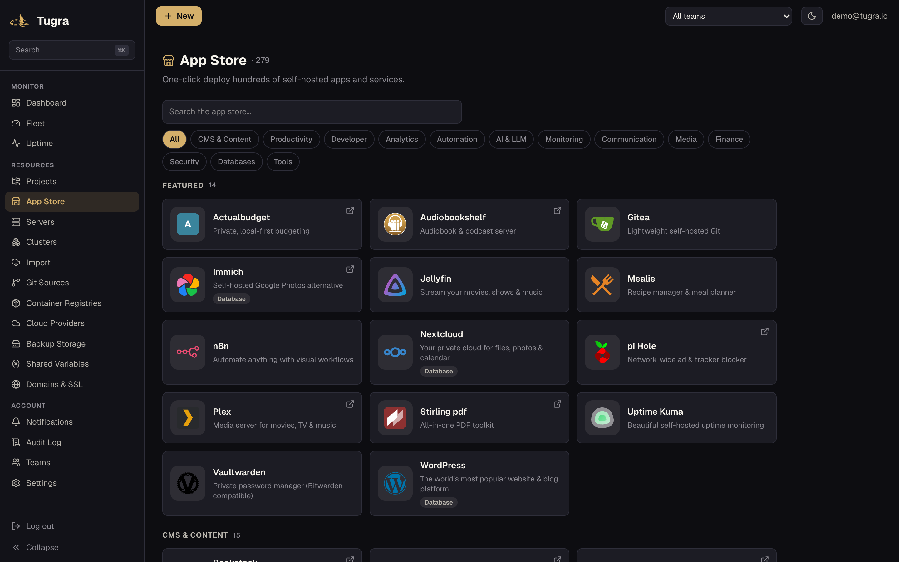
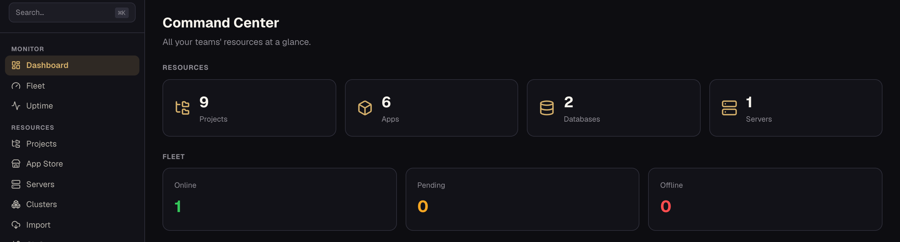
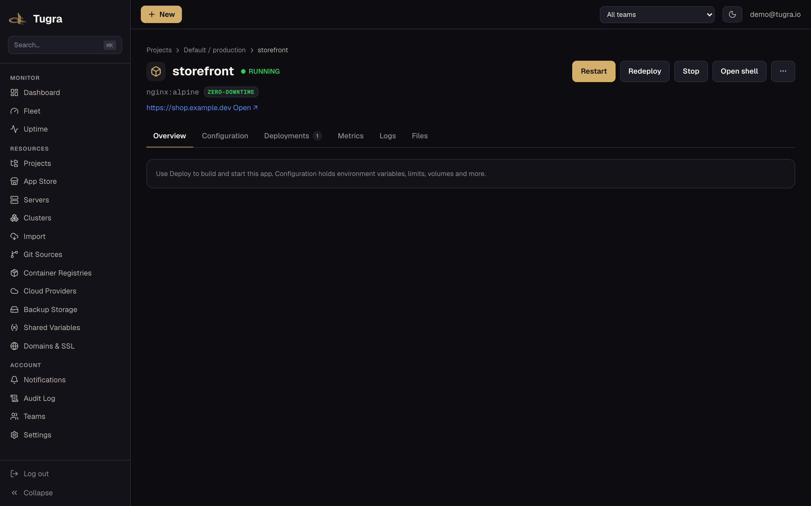
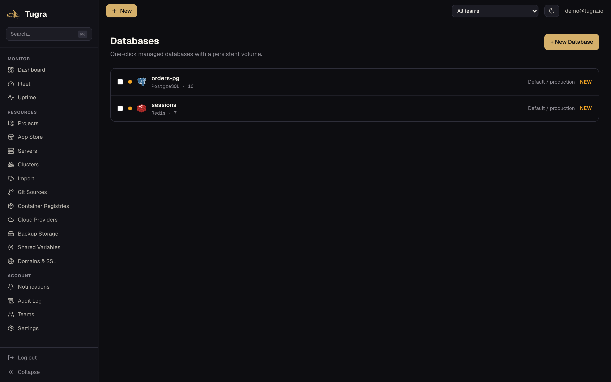
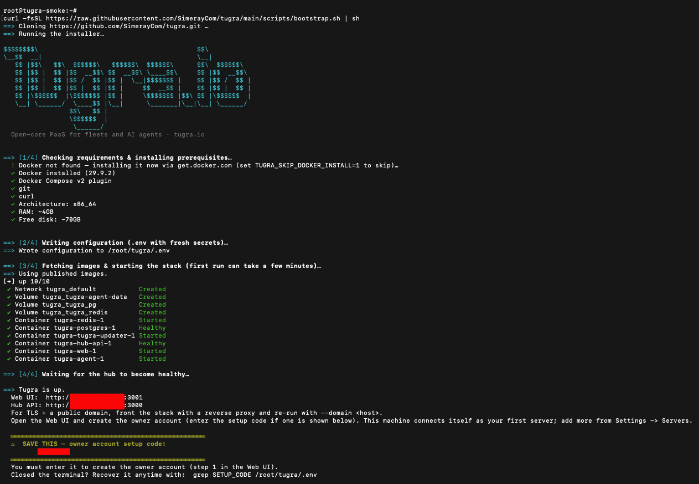

<div align="center">


# Tugra

*Tu sello en cada servidor.*

**PaaS open-core y autoalojable, creado para fleets y agentes de IA.**

[](https://github.com/SimerayCom/tugra/stargazers)
[](LICENSE)
[](https://github.com/SimerayCom/tugra/releases)
[](https://github.com/SimerayCom/tugra/actions/workflows/ci.yml)
[](#inicio-rápido)

[Sitio web](https://tugra.io) · [Documentación](docs/README.md) · [Publicación de versiones](docs/RELEASING.md) · [Hoja de ruta](#hoja-de-ruta)

[ English](README.md) · [ Türkçe](README.tr.md) ·  **Español** · [ Deutsch](README.de.md) · [ Français](README.fr.md) · [ Português](README.pt.md) · [ 简体中文](README.zh.md) · [ 日本語](README.ja.md)

</div>

---

> Los issues y los comentarios son bienvenidos. La [guía de pruebas](docs/beta-testing.md) explica qué probar y cómo reportar.

<div align="center">





&nbsp;

</div>

## Nativo para agentes por defecto

Tugra incluye un servidor [MCP](https://modelcontextprotocol.io) nativo: apunte Claude, Cursor o su propio agente a su infraestructura para que la inspeccione, haga deploy, escale y opere, con los mismos tokens de acceso personal, scopes y log de auditoría que la API REST. Sin paquete de integración aparte y sin devolver nunca valores secretos al modelo.

```bash
# List every tool the server exposes
curl -s https://your-tugra-host/api/v1/mcp \
  -H "Authorization: Bearer $TUGRA_PAT" \
  -H "Content-Type: application/json" \
  -d '{"jsonrpc":"2.0","id":1,"method":"tools/list"}'

# Ask it something real: what's actually deployed right now?
curl -s https://your-tugra-host/api/v1/mcp \
  -H "Authorization: Bearer $TUGRA_PAT" \
  -H "Content-Type: application/json" \
  -d '{"jsonrpc":"2.0","id":2,"method":"tools/call","params":{"name":"list_applications","arguments":{}}}'
```

Es el mismo endpoint `POST /api/v1/mcp`, la misma autenticación con token de acceso personal, los mismos scopes y la misma lista de IP permitidas que la API REST subyacente: no hay una credencial aparte que gestionar, y nunca se devuelven al modelo valores de secretos descifrados. El catálogo tiene **82 herramientas**: 45 de solo lectura (incluidos resúmenes de estado, salud y listado de apps de toda la fleet en una sola llamada, y un explorador de archivos de volumes en sandbox) y 37 herramientas de mutación/operaciones con scope de PAT (deploy · cancelar un deploy en cola · reiniciar · escalar en vivo · rollback · definir env · reiniciar un servidor (confirmación escrita, verificado después) · encender o apagar un servidor cloud en el proveedor, incluso con el agente sin conexión (confirmación escrita) · formar/ampliar un swarm · acciones sobre toda la fleet en un cluster · configuración de DNS de un dominio con un clic · la ejecución de migración guiada, en dry-run por defecto). Cada herramienta de mutación reutiliza exactamente las mismas comprobaciones de permisos de equipo y el mismo audit trail que la API REST, y las irreversibles (disolver un swarm, eliminar una app) exigen una confirmación explícita por nombre. OAuth para clientes de terceros sigue en la hoja de ruta.

## ¿Qué es Tugra?

Tugra es un plano de control open-core y autoalojable para hacer deploy, monitorear y operar apps y bases de datos en sus propios servidores: el día a día de Heroku, Render o Railway, sin entregar su infraestructura a la nube de otro. Su foco es la **fleet**: clusters reales de Docker Swarm entre sus servidores (no solo gestión de un servidor cada vez), operaciones masivas sobre toda la fleet y un servidor MCP integrado para operaciones dirigidas por IA, todo bajo una licencia que de verdad puede leer.

## Por qué Tugra

- **Primero la fleet, no un solo servidor** — agrupe servidores en clusters, forme un Docker Swarm real entre ellos y ejecute un comando en toda su fleet con una sola llamada de operaciones masivas, en lugar de entrar por SSH en cada servidor.
- **También nativo para agentes** — un servidor MCP integrado expone 82 herramientas (lectura + operaciones de mutación/fleet con scope de PAT) mediante `POST /api/v1/mcp`, con los mismos tokens de acceso personal y scopes que la API REST.
- **9 motores de bases de datos, un único flujo de trabajo** — PostgreSQL, MySQL, MariaDB, MongoDB, Redis, KeyDB, Dragonfly, ClickHouse y LibSQL, todos aprovisionados de la misma forma; ocho incluyen backups lógicos con dump/restore (LibSQL, que no tiene herramienta de dump, queda cubierto únicamente por backups de volumes a nivel de archivo: detenga primero la app para obtener una copia consistente).
- **TLS de verdad, comodines de verdad** — Let's Encrypt automático por app mediante Traefik, además de certificados comodín DNS-01 (`*.yourdomain.com`) para el ingress de cluster/Swarm, y no solo HTTP-01 para un único dominio.
- **Backups fuera del servidor** — dumps programados a disco local o a almacenamiento compatible con S3 (S3/R2/MinIO), opcionalmente cifrados (gpg AES-256) y con restore con un clic; los **simulacros de restore-verify** programados demuestran que un backup realmente se restaura, y PostgreSQL cuenta con **recuperación a un punto en el tiempo** (envío de WAL + base backups, restore a cualquier segundo desde el panel).
- **Deploys en los que puede confiar** — deploys progresivos con health gate y rollback automático si el gate falla (más un periodo de soak posterior al cutover, opt-in, que revierte automáticamente), rollouts de fleet (canary → oleadas → detención/rollback), build secrets que nunca acaban en la image y deploys que sobreviven a un reinicio del control plane.
- **Salir de Coolify desde el panel** — añada el servidor donde corre Coolify y siga **Import > Coolify > Connect through the agent**. Tugra lee la base de datos de Coolify a través de su agente (sin token de API), empareja los servidores de Coolify con los suyos según evidencias y toma cada servidor en el sitio, con las imágenes que Coolify ya construyó y los volumes que ya usa. Después limpia lo que Coolify dejó (nunca los volumes de datos), mueve proyectos completos entre servidores con rollback y apaga Coolify. «Give back to Coolify» deshace la toma de control con un clic hasta que se hace la limpieza. Véase [Move off Coolify](docs/move-off-coolify.md).
- **Open-core, no open-washed** — todo lo anterior se distribuye gratis bajo AGPL-3.0 en *este* repositorio. Las funciones Pro/Cloud (SSO, exportación del log de auditoría, marca blanca) se desbloquean con una clave firmada con licencia aparte: nada aquí le presiona para que pase a un plan de pago ni limita en silencio lo que puede hacer. Tugra envía estadísticas de uso anónimas, activadas por defecto: conteos agregados (servidores, apps, bases de datos, deploys, equipos, usuarios, clusters, monitores) junto con su versión, canal de releases, edición, sistema operativo, arquitectura de CPU y versión mayor de Node.js, bajo un id aleatorio; sin nombres, IP, dominios ni secretos, y el receptor no almacena su IP. Puede desactivarlas en cualquier momento con `--no-stats` / `TUGRA_STATS=0` o en Settings. La comprobación de actualizaciones también está activada por defecto: una descarga por hora de un manifiesto firmado de ~2 KB, sin identificadores; desactívela con `--no-update-checks` / `TUGRA_UPDATE_CHECKS=0`. La detección de la IP pública sigue siendo opt-in.

## Cómo se compara Tugra

Una comparación directa con las herramientas PaaS autoalojables que la gente evalúa de verdad (datos de la competencia verificados en 2026-11). `✅` integrado · `~` parcial / limitado · `—` sin equivalente integrado documentado · `🔜` en la hoja de ruta de Tugra. ¿Ha detectado algún error? [Abra un issue](https://github.com/SimerayCom/tugra/issues).

| | **Tugra** | Coolify | Dokploy | Portainer | CapRover | Dokku |
|---|---|---|---|---|---|---|
| **Deploy y build** | | | | | | |
| Dashboard de la Web UI | ✅ | ✅ | ✅ | ✅ | ✅ | — |
| Deploy desde Git | ✅ | ✅ | ✅ | ~ | ~ | ✅ |
| Deploy con Docker Compose | ✅ | ✅ | ✅ | ✅ | ~ | ~ |
| Deploys de vista previa (apps de PR) | ✅¹¹ | ✅ | ✅ | — | — | ~ |
| Rollbacks | ✅ | ✅ | ✅ | ~¹² | ✅ | ~ |
| App Store / plantillas con un clic | ✅ | ✅ | ✅ | ✅ | ✅ | — |
| **Datos** | | | | | | |
| Motores de bases de datos gestionados | **9** | 9 (SQLite experimental)¹² | 6 | — | — | ~¹² |
| Backups programados en S3 + restore | ✅ | ✅ | ✅ | — | — | ~ |
| Backups de volumes Docker de apps (a nivel de archivo, no un snapshot) | ✅ | ~¹² | ✅ | — | — | — |
| **Dominios y TLS** | | | | | | |
| Dominios personalizados + SSL automático | ✅ | ✅ | ✅ | — | ✅ | ✅ |
| Certificados comodín DNS-01 | ✅ | ~ | — | — | ~¹² | ~ |
| **Fleet y alta disponibilidad** | | | | | | |
| Clustering multi-node | ✅ Swarm | Individual¹ | ✅ Swarm | ✅ | ✅ | ~ k3s⁶ |
| HA Raft multi-manager + HA de ingress | ✅ | — | — | — | — | — |
| Operaciones masivas sobre toda la fleet (una llamada) | ✅ | — | — | — | — | — |
| Parcheo del SO (por servidor + fleet) | ✅ | ~¹² | — | — | — | — |
| Recuperación a un punto en el tiempo (WAL de PostgreSQL) | ✅¹⁰ | — | — | — | — | — |
| Simulacros programados de restore-verify | ✅ | — | — | — | — | — |
| Rollouts de fleet (canary → oleadas → detención/rollback automáticos) | ✅ | — | — | ~¹² | — | — |
| Rollback automático tras el cutover (ventana de soak, opt-in por app) | ✅ | — | ~¹² | — | — | — |
| **Observabilidad** | | | | | | |
| Métricas integradas (CPU/RAM/disco) | ✅ | ~ | ✅ | ~ | ~¹² | — |
| Monitores de disponibilidad + notificaciones | ✅ | ~ | ~¹² | — | — | — |
| Visor de logs de apps / containers | ✅ | ✅ | ✅ | ✅ | ✅ | ✅ |
| **Acceso y agentes** | | | | | | |
| Equipos / RBAC | ✅ | ✅ | ✅ | ~⁷ | — | — |
| SSO / OIDC | ✅ (Pro)⁸ | ✅ | ✅ | ~⁷ | — | — |
| Log de auditoría | ✅ | ✅ | ✅ | ~⁷ | — | — |
| MCP / control por agentes | ✅ 82 tools⁵ | ✅ | ✅ | ~⁷ | — | ~² |
| **Confianza y licencia** | | | | | | |
| Estadísticas de uso | Anónima, opt-out (solo conteos) | n/a | n/a | n/a | n/a | n/a |
| Migrar a Tugra (importar desde Coolify) | ✅⁹ | — | — | — | — | — |
| Licencia del núcleo | AGPL-3.0 | Apache-2.0 | Apache-2.0³ | zlib + BE⁷ | Apache-2.0 + condiciones⁴ | MIT |

<sub>¹ Coolify v4 gestiona los servidores de forma individual (sin clustering integrado); su soporte de Docker Swarm está obsoleto (eliminación prevista en v5), y desplegar una image en varios servidores requiere su propio balanceador de carga. ² Un proyecto MCP de Dokku de terceros, en fase temprana, que no es una versión oficial. ³ El núcleo de Dokploy es Apache-2.0; una licencia Source-Available aparte cubre su directorio empresarial `proprietary/` (SSO, logs de auditoría, marca blanca), el mismo esquema open-core que usa Tugra. ⁴ El `LICENSE` de CapRover es Apache-2.0 con un apéndice que restringe la modificación y la redistribución de las funciones de pago. ⁵ Tugra, Coolify y Dokploy incluyen servidores MCP con herramientas de lectura y escritura. Tugra añade acciones sobre toda la fleet (una llamada sobre un cluster), confirmación por nombre en las herramientas destructivas y ocultación de secretos. ⁶ Dokku no es compatible con Docker Swarm; su opción multi-node es el plugin `scheduler-k3s` (k3s/Kubernetes), una arquitectura distinta. ⁷ El RBAC completo, las plantillas de SSO AD/OIDC y los logs de auditoría de Portainer son Business Edition (gratis hasta 3 nodos); Community incluye usuarios básicos y LDAP/OAuth limitado. Su repositorio oficial de servidor MCP no tiene soporte; la vía de IA con soporte (Portainer Command) es Business Edition. ⁸ El núcleo de Tugra es gratuito y completo (equipos/RBAC, log de auditoría, backups, monitoreo, MCP, migrador, HA multi-node); el SSO/OIDC es una función Pro. ⁹ Lee Coolify a través del agente de Tugra en su servidor (sin token de API) o mediante la API de Coolify, y luego toma cada servidor en el sitio o lo copia a otro servidor; un adoptador local de Docker aparte toma el control de los containers del mismo host sin moverlos (conservando sus volumes con nombre). Los **datos** de las bases de datos Postgres, MySQL, MariaDB, MongoDB, ClickHouse, Redis, KeyDB y Dragonfly se trasladan entre hosts con un migrador de un solo comando que usted pega en el host de Coolify, los datos de **volumes** de las apps con la copia de volumes en streaming y reanudable del migrador, y los de LibSQL con `tar`/`rsync` ([docs/move-off-coolify.md](docs/move-off-coolify.md), [docs/coolify-migration.md](docs/coolify-migration.md)). ¹⁰ Solo PostgreSQL; los demás motores conservan dumps lógicos programados. ¹¹ Los eventos de pull/merge request de GitHub, GitLab, Gitea/Forgejo y Bitbucket (Cloud y Server) crean, actualizan y eliminan previews; las previews requieren una app construida desde Git con previews activadas, y los pull requests de forks se ignoran. ¹² Notas sobre la competencia tomadas de la documentación oficial, 2026-11: Coolify Server Patching es por servidor y está en Beta, sus backups de storage no tienen restore desde la UI, y documenta 9 motores de BD pero backups programados solo para 6; los umbrales de monitoreo de Dokploy están marcados como solo Cloud y su rollback es el rollback de actualización nativo de Docker Swarm que usted mismo configura; el rollout de grupo estilo canary de Portainer es Business Edition y solo para Edge Stacks; DNS-01 de CapRover y el monitoreo con Netdata son configuraciones manuales/opt-in; los motores de base de datos de Dokku son plugins oficiales de CLI sin UI. Los nombres de productos son marcas comerciales de sus respectivos propietarios; Tugra no está afiliado a ellos ni cuenta con su aval.</sub>

## Inicio rápido

En un host Linux limpio, **un solo comando** instala los requisitos previos (git, Docker), clona el repositorio y levanta el stack. Sin dominio, sin token de Cloudflare, sin más configuración: el panel queda en `http://<server-ip>/` (puerto 80, servido por el proxy propio de Tugra, así que solo hace falta abrir los puertos 80/443):

```bash
curl -fsSL https://tugra.io/install | sh
```

Después abra la URL que se imprime, cree la cuenta de owner y, cuando tenga un dominio, configúrelo en **Settings → Instance → Panel domain** (HTTPS gratis con Let's Encrypt, sin token, funciona detrás de la nube naranja de Cloudflare). Si quiere tener el dominio desde el primer minuto, apunte su DNS al servidor y añádalo al mismo comando:

```bash
curl -fsSL https://tugra.io/install | sh -s -- --domain panel.example.com
```

<p align="center"></p>

¿Prefiere leer el script antes de ejecutarlo (lo sensato con cualquier script al que se le da acceso a Docker, casi equivalente a acceso root)? Clone el repositorio y ejecute usted mismo el instalador: solo escribe un `.env` local y llama a `docker compose`, instala Docker si falta y es idempotente (puede volver a ejecutarlo sin riesgo):

```bash
git clone https://github.com/SimerayCom/tugra.git
cd tugra
less scripts/install.sh   # review it first
./scripts/install.sh
```

El instalador genera secretos robustos en un `.env` local (si lo vuelve a ejecutar, se conservan) y después levanta el hub, la Web UI, PostgreSQL y Redis con `docker compose`. Cuando termina, abra la URL de la **Web UI** que imprime (`http://<host-ip>/`, o `https://<your-domain>` con `--domain`) y cree la primera cuenta: pasa a ser el **propietario** de la instancia. En una instalación nueva, el instalador también imprime un **código de configuración** de un solo uso que debe introducir al crear esa cuenta (puede recuperarlo con `grep SETUP_CODE .env`). Después, siga el asistente de onboarding para conectar su primer servidor.

Volver a ejecutar `./scripts/install.sh` (p. ej. tras un `git pull`) es seguro: conserva sus secretos y solo actualiza la configuración, así que sirve también como vía de actualización.

**Producción (TLS + dominio).** `--domain` hace que el proxy propio de Tugra sirva el panel por HTTPS con un certificado de Let's Encrypt automático (HTTP-01; no hace falta correo ni token de Cloudflare). Apunte antes el DNS del dominio al servidor. O prescinda de la opción y configure el dominio más tarde en **Settings → Instance → Panel domain**: la dirección anterior sigue funcionando hasta que se emite el certificado, y el cambio se revierte si no se puede emitir. Para poner Tugra detrás de su **propio** reverse proxy, use `--no-auto-tls` (también se elige solo cuando otro servicio ya ocupa :80/:443) y enrute como se indica abajo:

```bash
./scripts/install.sh --domain tugra.example.com --no-auto-tls
```

Dirija la mayor parte del tráfico a la **web** (`:3001`), que se encarga de reenviar al hub la API REST y el inicio de OAuth, y envíe al **hub** (`:3000`) únicamente las rutas que la web no puede gestionar:

| Prefijo de ruta | → |
|---|---|
| `/agent`, `/terminal` (WebSocket), `/install`, `/webhooks`, `/auth/oauth` | hub `:3000` |
| todo lo demás (`/`, `/api/*`) | web `:3001` |

Notas:

- **TLS:** automático por defecto con `--domain` (Traefik incluido + Let's Encrypt; `--acme-email you@domain` es un contacto opcional para avisos de caducidad), o traiga su propio reverse proxy (Caddy, Traefik, nginx, …) con `--no-auto-tls`. Detrás de la nube naranja de Cloudflare funciona sin token; si el primer certificado no se emite, ponga el modo SSL/TLS en **Full** y desactive **Always Use HTTPS** hasta que se emita (un token DNS-01 con `--acme-dns-cloudflare-file` es una alternativa opcional). `--domain` establece `COOKIE_SECURE=true` + `HUB_TRUSTED_PROXY=true`.
- **Inicio rápido clásico de dos puertos.** `--raw-ports` mantiene el diseño anterior (sin proxy; web `:3001`, hub `:3000`); es también lo que conserva una instalación hecha antes de este cambio y lo que recibe un host con el puerto 80 ya ocupado.
- **Restrinja el acceso a los puertos directos.** Con `HUB_TRUSTED_PROXY=true`, el hub respeta `X-Forwarded-For` (solo desde peers privados, de loopback o de docker, o desde `HUB_TRUSTED_PROXY_CIDRS`), y los puertos directos `:3000`/`:3001` deberían ser accesibles **solo** para el proxy. Una instalación nueva con `--domain` los vincula a `127.0.0.1` (proxy en el mismo host), y una instalación existente que pasa a https también se mueve ahí (`--keep-raw-ports` lo desactiva). Si el proxy se ejecuta en otro host, defina `HUB_BIND`/`WEB_BIND` con la IP de la interfaz privada de esta máquina y proteja los puertos con un firewall: los puertos que publica Docker se saltan `ufw`.
- **«Sign in with GitHub»** solo funciona en este deploy con proxy de origen único (el hub y la web comparten un origen público para que la SPA vea la cookie de sesión); no está disponible en el inicio rápido básico de dos puertos.

> Las images publicadas (`ghcr.io/simeraycom/tugra-*`) se descargan automáticamente; en un host sin image publicada para su arquitectura, el instalador hace el build a partir de su copia local del repositorio: el mismo comando, sin cambios. Cada versión se fija por digest y se distribuye con provenance firmada; consulte [docs/upgrade.md](docs/upgrade.md).

**Inicio rápido de MCP.** Cuando Tugra esté en marcha, genere un token de acceso personal (**Settings → API tokens**) y apunte cualquier cliente MCP a su instancia:

```bash
curl -s http://<web-url>/api/v1/mcp \
  -H "Authorization: Bearer $TUGRA_PAT" -H "Content-Type: application/json" \
  -d '{"jsonrpc":"2.0","id":1,"method":"initialize"}'
```

## Autoalojado frente a nube

Todo lo de [Por qué Tugra](#por-qué-tugra) es **gratuito y de código abierto para siempre**, bajo AGPL-3.0, autoalojado en sus propios servidores: sin límites artificiales y sin ningún feature flag esperando a activarse a cambio de dinero. La edición Community de este repositorio es el producto de verdad, no una demo limitada.

Las ediciones Pro y Cloud (SSO, exportación del log de auditoría, marca blanca, plano de control gestionado) se ofrecen bajo una licencia comercial aparte. Si necesita una licencia distinta de la AGPL, o algo que Community no puede hacer, escriba a **license@tugra.io**.

## Arquitectura

| Componente | Stack |
|---|---|
| Hub (API + cerebro) | NestJS · PostgreSQL (Prisma) · Redis / BullMQ |
| Web | Next.js |
| Agente | Go (un único binario, por servidor) |
| Proxy | Traefik (SSL automático, incl. comodín DNS-01) |

Los logs en vivo, las métricas y la terminal se transmiten por WebSockets. Desglose completo en [docs/architecture.md](docs/architecture.md).

## Hoja de ruta

**Completado** (hasta v0.1.0-beta.33)

- [x] Protocolo Hub ↔ Agente + alta de servidores (WSS saliente · ed25519 · comandos firmados + scope de capacidades)
- [x] Deploy desde Git / Docker Compose / image (Nixpacks · Railpack · buildpacks de Heroku · Dockerfile · sitio estático)
- [x] Reverse proxy + SSL automático (Traefik · Let's Encrypt, incl. comodín DNS-01)
- [x] Métricas en vivo, logs de build y terminal web (flujos WebSocket; la terminal está protegida por capability y desactivada por defecto)
- [x] Bases de datos (9 motores) con backups y restore (local + fuera del servidor en S3/R2)
- [x] Clusters multiservidor + formación de Docker Swarm, operaciones masivas sobre toda la fleet
- [x] Servidor MCP nativo — 82 herramientas (lectura + operaciones de mutación/fleet con scope de PAT) + prompts guiados
- [x] App Store — más de 280 plantillas con un clic + lanzador en modo Home
- [x] Gestor de archivos para volumes de apps — explorar, descargar, subir, editar, renombrar, cambiar permisos y eliminar (la escritura es una capability opcional del servidor; Web UI, y MCP `list_files` para lectura)
- [x] Deploys de vista previa (por pull request)
- [x] Monitoreo de disponibilidad (HTTP/TCP/métricas) + 12 canales de notificación (webhook · Telegram · ntfy · Discord · Slack · Gotify · SMTP · Pushover · Teams · Mattermost · Lark · Resend)
- [x] Tareas programadas (cron) · rollbacks · límites de recursos y health checks
- [x] Proyectos / entornos · equipos, roles e invitaciones · etiquetas · variables compartidas
- [x] API pública (OpenAPI) + CLI (`tugra`)
- [x] Parcheo de servidores (actualizaciones de paquetes del SO), ejecutado en el host como unidad transitoria de systemd para que una actualización de Docker/containerd no lo interrumpa a medias; las actualizaciones escalonadas (phased) de Ubuntu se listan aparte · Limpieza de Docker como la de Coolify (diaria y, además, cuando el disco de un servidor supera su umbral; la página del servidor muestra qué borra y qué nunca borra)
- [x] Reinicio de un servidor desde el panel (ahora o programado hasta con 7 días de antelación) con vista previa del impacto y, después, una comprobación automática de que Docker, cada container que estaba en marcha, cada dominio enrutado y la marca de reinicio pendiente han vuelto; solo manual, también en la CLI y en MCP
- [x] Self-update (versiones firmadas) + onboarding guiado
- [x] Migrador — adopta containers Docker locales + importa desde Coolify (asistente web, mediante el agente de Tugra o la API) y Dokploy (asistente web / API / MCP / CLI) (conectar · planificar · aplicar · rollback) + migración de datos de bases de datos entre hosts con un solo comando (Postgres · MySQL · MariaDB · Redis · KeyDB · Dragonfly) + copia de volumes de apps en streaming y reanudable + una ejecución de migración guiada y reanudable (`tugra import run` y las herramientas MCP `migration_run_*`: primero dry-run, aprobaciones escritas, aborto/reversión) con una vía de dump en streaming para bases de datos grandes (Postgres · MySQL · MariaDB) — comprobada con Coolify 4.1.2 y 4.7.5 (límites de la API, nombres de container con marca de tiempo, tokens `read:sensitive`)
- [x] Move off Coolify — leer Coolify a través del agente de su servidor, emparejar sus servidores según evidencias, tomar cada uno en el sitio (imágenes y volumes se conservan, devolución con un clic), limpiar lo que quede, mover proyectos completos entre servidores con rollback, una campaña por equipo; véase [docs/move-off-coolify.md](docs/move-off-coolify.md)
- [x] Simulacros de restore-verify (programados, con un watchdog de liveness) · recuperación a un punto en el tiempo de PostgreSQL (envío de WAL · base backups · restore a cualquier segundo)
- [x] Deploys progresivos con health gate + soak posterior al cutover opt-in y reversión automática · rollouts de fleet (canary → oleadas → health gate → detener/reanudar/rollback)
- [x] Los deploys sobreviven a un reinicio del hub (journal de comandos del agent + adopción del resultado) · página de detalle por deploy (línea de tiempo · log en vivo · diff de configuración)
- [x] Build secrets con `--secret` de BuildKit (builds con Dockerfile) · rotación de la master key (job de re-cifrado reanudable, no hay que volver a introducir nada, las apps no se tocan; el hub se reinicia dos veces) · self-updates firmados y fijados por digest, con un punto de restore previo a la actualización
- [x] Aprovisionamiento de servidores cloud (Hetzner · DigitalOcean · Vultr) · Cloudflare Tunnel · analítica de tráfico integrada (GeoIP local, sin phone-home) · [log drains](docs/log-drains.md) · registries privados · proveedor de secretos Vault (Pro)

**Próximamente**

- [ ] OAuth para MCP en clientes de terceros (registro dinámico de clientes, PKCE)
- [ ] Más fuentes de migración (CapRover)
- [ ] App móvil

## Comunidad y documentación

- [Documentación completa](docs/README.md) — instalación, arquitectura, API, CLI, seguridad, open-core
- [Issues](https://github.com/SimerayCom/tugra/issues) — informes de errores y solicitudes de funciones
- [Discussions](https://github.com/SimerayCom/tugra/discussions) — preguntas, ideas y proyectos para compartir
- [Cómo contribuir](CONTRIBUTING.md) · [Código de conducta](CODE_OF_CONDUCT.md) · [CLA](CLA.md)
- [Política de seguridad](SECURITY.md)

## Colaboradores

<a href="https://github.com/SimerayCom/tugra/graphs/contributors">
  
</a>

## Patrocinadores

Tugra se construye y se mantiene en abierto. Si le resulta útil a usted o a su equipo, considere [patrocinar el proyecto en GitHub](https://github.com/sponsors/mrcandev): todavía no hay ningún nivel de patrocinio, así que usted sería el primero, y cada aportación ayuda a mantener el desarrollo independiente.

## Historial de estrellas

[](https://star-history.com/#SimerayCom/tugra&Date)

## Licencia

Tugra usa un modelo **open-core**:

- **Núcleo** (este repositorio) — [GNU AGPLv3](LICENSE). Libre para usar, autoalojar, estudiar y modificar. Si ejecuta una versión modificada como servicio de red, debe compartir sus cambios bajo la misma licencia.
- **Agente y CLI** — [MIT](agent/LICENSE). Úselos donde quiera, sin condiciones.
- **Tugra Cloud y funciones Pro** — propietarios, aún sin publicar (consulte [Autoalojado frente a nube](#autoalojado-frente-a-nube)).

**Licencia comercial:** si no puede cumplir la AGPLv3 (p. ej., quiere crear un producto propietario o un servicio SaaS sobre Tugra), hay disponible una licencia comercial. Escriba a **license@tugra.io**. Desglose completo en [docs/open-core.md](docs/open-core.md).

---

<div align="center"><sub>AGPL-3.0 © Simeray Ltd — consulte <a href="LICENSE">LICENSE</a>.</sub></div>
