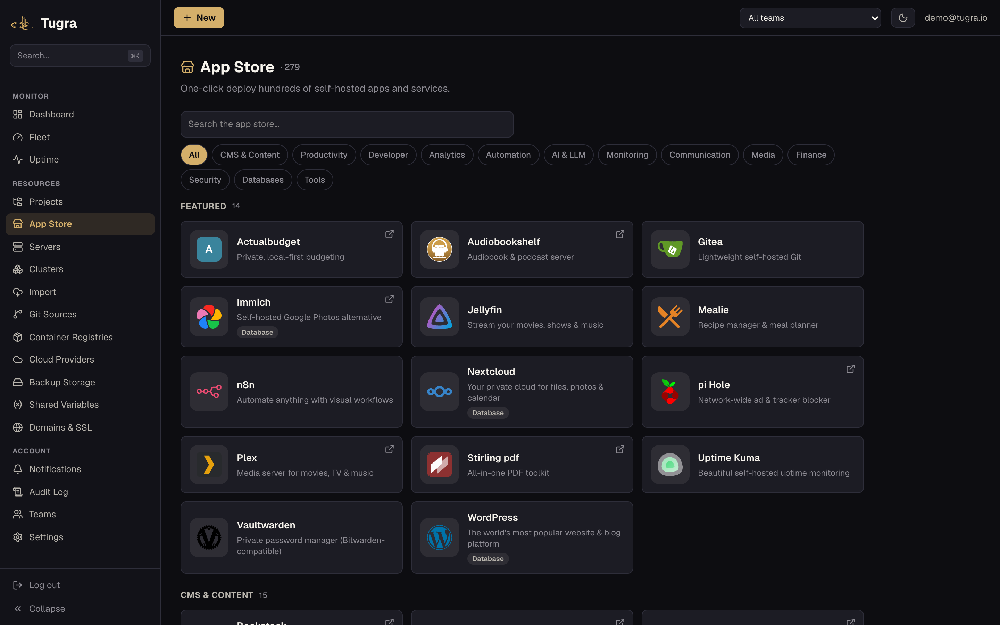
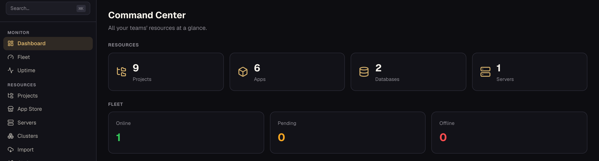
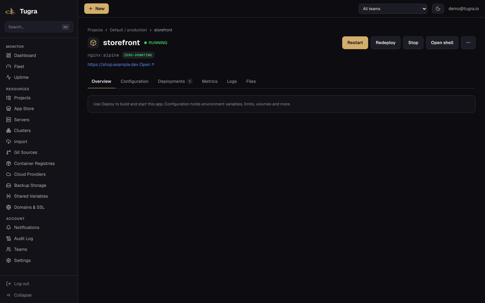
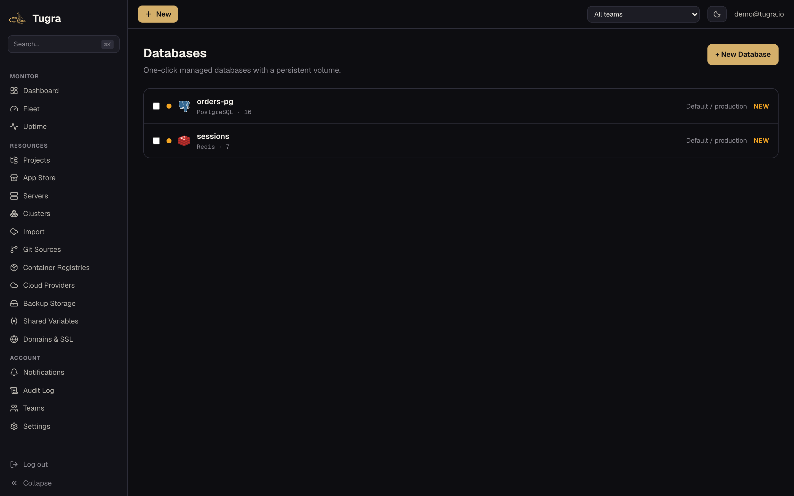
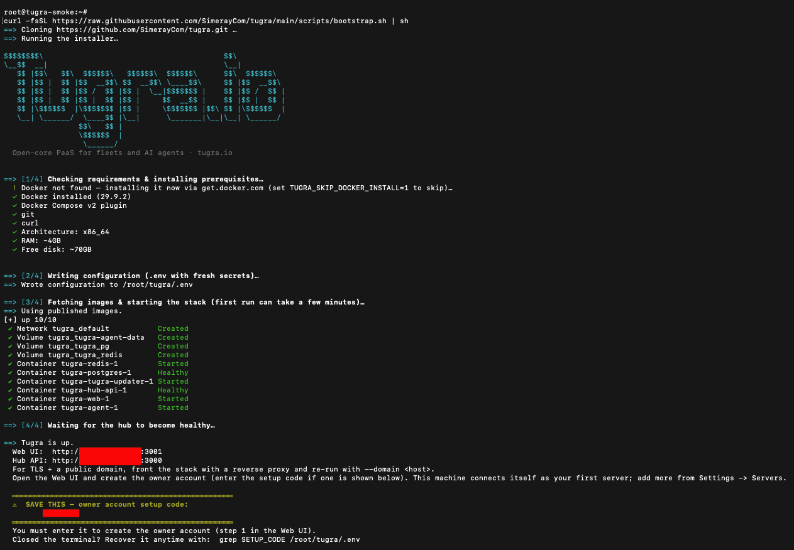

<div align="center">


# Tugra

*Seu selo em cada servidor.*

**PaaS open-core e auto-hospedável, feito para frotas e agentes de IA.**

[](https://github.com/SimerayCom/tugra/stargazers)
[](LICENSE)
[](https://github.com/SimerayCom/tugra/releases)
[](https://github.com/SimerayCom/tugra/actions/workflows/ci.yml)
[](#início-rápido)

[Site](https://tugra.io) · [Documentação](docs/README.md) · [Publicação de versões](docs/RELEASING.md) · [Roteiro](#roteiro)

[ English](README.md) · [ Türkçe](README.tr.md) · [ Español](README.es.md) · [ Deutsch](README.de.md) · [ Français](README.fr.md) ·  **Português** · [ 简体中文](README.zh.md) · [ 日本語](README.ja.md)

</div>

---

> Issues e feedback são bem-vindos. O [guia de testes](docs/beta-testing.md) mostra o que experimentar e como reportar.

<div align="center">





&nbsp;

</div>

## Nativo para agentes, por padrão

O Tugra traz um servidor [MCP](https://modelcontextprotocol.io) nativo — aponte o Claude, o Cursor ou o seu próprio agente para a sua infraestrutura para inspecioná-la, fazer deploy, escalar e operá-la, usando os mesmos tokens de acesso pessoal, escopos e trilha de auditoria da API REST. Sem pacote de integração separado e sem que nenhum valor de segredo seja jamais devolvido ao modelo.

```bash
# List every tool the server exposes
curl -s https://your-tugra-host/api/v1/mcp \
  -H "Authorization: Bearer $TUGRA_PAT" \
  -H "Content-Type: application/json" \
  -d '{"jsonrpc":"2.0","id":1,"method":"tools/list"}'

# Ask it something real: what's actually deployed right now?
curl -s https://your-tugra-host/api/v1/mcp \
  -H "Authorization: Bearer $TUGRA_PAT" \
  -H "Content-Type: application/json" \
  -d '{"jsonrpc":"2.0","id":2,"method":"tools/call","params":{"name":"list_applications","arguments":{}}}'
```

É o mesmo endpoint `POST /api/v1/mcp`, a mesma autenticação por token de acesso pessoal, os mesmos scopes e a mesma lista de IPs permitidos da API REST por baixo — sem credencial separada para gerenciar, e nenhum valor de segredo descriptografado é devolvido ao modelo. O catálogo tem **82 ferramentas**: 45 somente leitura (incluindo resumos de status, saúde e listagem de apps de toda a frota em uma só chamada, e um navegador de arquivos de volumes em sandbox), mais 37 ferramentas de mutação/operações com scope de PAT (deploy · cancelar um deploy na fila · reiniciar · escalar ao vivo · rollback · definir env · reiniciar um servidor (confirmação digitada, verificado depois) · ligar ou desligar um servidor cloud no provedor, mesmo com o agente offline (confirmação digitada) · formar/ampliar um swarm · ações em toda a frota sobre um cluster · configuração de DNS de um domínio com um clique · a execução de migração guiada, em dry-run por padrão). Toda ferramenta de mutação reutiliza exatamente as mesmas verificações de permissão de equipe e o mesmo audit trail da API REST, e as irreversíveis (dissolver um swarm, remover um app) exigem confirmação explícita pelo nome. O OAuth para clientes de terceiros continua no roteiro.

## O que é o Tugra?

O Tugra é um plano de controle open-core e auto-hospedável para fazer deploy, monitorar e operar apps e bancos de dados nos seus próprios servidores — o dia a dia do Heroku, do Render ou do Railway, sem entregar a sua infraestrutura à nuvem de outra pessoa. O foco é a **frota**: clusters Docker Swarm de verdade entre os seus servidores (e não apenas o gerenciamento de uma máquina por vez), operações em massa em toda a frota e um servidor MCP integrado para operações conduzidas por IA — tudo sob uma licença que você realmente pode ler.

## Por que Tugra

- **Frota em primeiro lugar, não máquina única** — agrupe servidores em clusters, forme um Docker Swarm de verdade entre eles e execute um comando em toda a frota com uma única chamada de operações em massa, em vez de acessar cada máquina via SSH.
- **Nativo para agentes também** — um servidor MCP integrado expõe 82 ferramentas (leitura + operações de escrita/frota com escopo de PAT) via `POST /api/v1/mcp`, com escopo definido pelos mesmos tokens de acesso pessoal da API REST.
- **9 engines de banco de dados, um único fluxo** — PostgreSQL, MySQL, MariaDB, MongoDB, Redis, KeyDB, Dragonfly, ClickHouse e LibSQL, todos provisionados da mesma forma; oito têm backups lógicos de dump/restore integrados (o LibSQL, que não tem ferramenta de dump, é coberto apenas por backups de volume em nível de arquivo — pare o app antes para obter uma cópia consistente).
- **TLS de verdade, wildcards de verdade** — Let's Encrypt automático por app via Traefik, além de certificados wildcard DNS-01 (`*.yourdomain.com`) para ingress em cluster/Swarm — não apenas HTTP-01 para um único domínio.
- **Backups fora do servidor** — dumps agendados para disco local ou armazenamento compatível com S3 (S3/R2/MinIO), opcionalmente criptografados (gpg AES-256), com restore com um clique; **simulações de restore-verify** agendadas comprovam que um backup realmente restaura, e o PostgreSQL conta com **recuperação para um ponto no tempo** (envio de WAL + base backups, restore para qualquer segundo a partir do painel).
- **Deploys em que você pode confiar** — deploys progressivos com health gate e rollback automático em caso de falha do gate (mais um período de soak pós-cutover, opt-in, que reverte automaticamente), rollouts de frota (canary → ondas → parada/rollback), build secrets que nunca vão parar na imagem e deploys que sobrevivem a uma reinicialização do control plane.
- **Sair do Coolify pelo painel** — adicione o servidor onde o Coolify roda e siga **Import > Coolify > Connect through the agent**. O Tugra lê o banco de dados do próprio Coolify pelo agente (sem token de API), associa os servidores do Coolify aos seus com base em evidências e assume cada servidor no próprio lugar, com as imagens que o Coolify já construiu e os volumes que ele já usa. Depois você limpa o que o Coolify deixou (nunca os volumes de dados), move projetos inteiros entre servidores com rollback e desliga o Coolify. "Give back to Coolify" desfaz a assunção com um clique até a limpeza. Veja [Move off Coolify](docs/move-off-coolify.md).
- **Open-core de verdade, não open-washing** — tudo o que está acima é distribuído gratuitamente sob AGPL-3.0 *neste* repositório. Os recursos Pro/Cloud (SSO, exportação do log de auditoria, whitelabel) são liberados por uma chave assinada com licença separada — nada aqui fica pressionando você a fazer upgrade nem limita silenciosamente o que você pode fazer. O Tugra envia estatísticas de uso anônimas, ativadas por padrão — contagens agregadas (servidores, apps, bancos de dados, deploys, equipes, usuários, clusters, monitores) mais a sua versão, canal de release, edição, SO, arquitetura de CPU e versão principal do Node.js, associadas a um ID aleatório; sem nomes, IPs, domínios ou segredos, e o servidor que recebe os dados não armazena o seu IP — e você pode desativá-las a qualquer momento com `--no-telemetry` / `TUGRA_TELEMETRY=0` ou em Settings. A verificação de atualizações também vem ativada por padrão: uma busca por hora de um manifesto assinado de ~2 KB, sem identificadores; desative com `--no-update-checks` / `TUGRA_UPDATE_CHECKS=0`. A detecção de IP público continua sendo opt-in.

## Como o Tugra se compara

Uma comparação lado a lado com as ferramentas de PaaS auto-hospedáveis que as pessoas realmente avaliam (dados dos concorrentes verificados em 2026-11). `✅` integrado · `~` parcial / limitado · `—` sem equivalente integrado documentado · `🔜` no roteiro do Tugra. Encontrou algum erro? [Abra uma issue](https://github.com/SimerayCom/tugra/issues).

| | **Tugra** | Coolify | Dokploy | Portainer | CapRover | Dokku |
|---|---|---|---|---|---|---|
| **Deploy e build** | | | | | | |
| Painel web (UI) | ✅ | ✅ | ✅ | ✅ | ✅ | — |
| Deploy a partir do Git | ✅ | ✅ | ✅ | ~ | ~ | ✅ |
| Deploy com Docker Compose | ✅ | ✅ | ✅ | ✅ | ~ | ~ |
| Deploys de preview (apps de PR) | ✅¹¹ | ✅ | ✅ | — | — | ~ |
| Rollbacks | ✅ | ✅ | ✅ | ~¹² | ✅ | ~ |
| App store / templates de um clique | ✅ | ✅ | ✅ | ✅ | ✅ | — |
| **Dados** | | | | | | |
| Engines de banco de dados gerenciados | **9** | 9 (SQLite experimental)¹² | 6 | — | — | ~¹² |
| Backups S3 agendados + restore | ✅ | ✅ | ✅ | — | — | ~ |
| Backups de volumes Docker dos apps (em nível de arquivo, não um snapshot) | ✅ | ~¹² | ✅ | — | — | — |
| **Domínios e TLS** | | | | | | |
| Domínios personalizados + SSL automático | ✅ | ✅ | ✅ | — | ✅ | ✅ |
| Certificados wildcard DNS-01 | ✅ | ~ | — | — | ~¹² | ~ |
| **Frota e HA** | | | | | | |
| Cluster multi-node | ✅ Swarm | Individual¹ | ✅ Swarm | ✅ | ✅ | ~ k3s⁶ |
| HA Raft multi-manager + HA de ingress | ✅ | — | — | — | — | — |
| Operações em massa na frota (uma chamada) | ✅ | — | — | — | — | — |
| Patching do SO (por servidor + frota) | ✅ | ~¹² | — | — | — | — |
| Recuperação para um ponto no tempo (WAL do PostgreSQL) | ✅¹⁰ | — | — | — | — | — |
| Simulações agendadas de restore-verify | ✅ | — | — | — | — | — |
| Rollouts de frota (canary → ondas → parada/rollback automáticos) | ✅ | — | — | ~¹² | — | — |
| Rollback automático pós-cutover (janela de soak, opt-in por app) | ✅ | — | ~¹² | — | — | — |
| **Observabilidade** | | | | | | |
| Métricas integradas (CPU/RAM/disco) | ✅ | ~ | ✅ | ~ | ~¹² | — |
| Monitores de uptime + notificações | ✅ | ~ | ~¹² | — | — | — |
| Visualizador de logs de app / contêiner | ✅ | ✅ | ✅ | ✅ | ✅ | ✅ |
| **Acesso e agentes** | | | | | | |
| Equipes / RBAC | ✅ | ✅ | ✅ | ~⁷ | — | — |
| SSO / OIDC | ✅ (Pro)⁸ | ✅ | ✅ | ~⁷ | — | — |
| Log de auditoria | ✅ | ✅ | ✅ | ~⁷ | — | — |
| MCP / controle por agentes | ✅ 82 tools⁵ | ✅ | ✅ | ~⁷ | — | ~² |
| **Confiança e licença** | | | | | | |
| Estatísticas de uso | Anônima, opt-out (somente contagens) | n/a | n/a | n/a | n/a | n/a |
| Migrar para cá (importar do Coolify) | ✅⁹ | — | — | — | — | — |
| Licença do núcleo | AGPL-3.0 | Apache-2.0 | Apache-2.0³ | zlib + BE⁷ | Apache-2.0 + termos⁴ | MIT |

<sub>¹ O Coolify v4 gerencia os servidores individualmente (sem clustering integrado); o suporte a Docker Swarm está obsoleto (remoção prevista na v5), e fazer deploy de uma imagem em vários servidores exige o seu próprio load balancer. ² Um projeto de MCP para o Dokku feito por terceiros, ainda em estágio inicial, e não um lançamento oficial. ³ O núcleo do Dokploy é Apache-2.0; uma licença Source-Available separada cobre o diretório enterprise `proprietary/` (SSO, logs de auditoria, whitelabel) — o mesmo modelo open-core que o Tugra usa. ⁴ O `LICENSE` do CapRover é Apache-2.0, com um apêndice que restringe a modificação e a redistribuição de funcionalidades pagas. ⁵ O Tugra, o Coolify e o Dokploy distribuem servidores MCP com ferramentas de leitura e escrita. O Tugra acrescenta ações em toda a frota (uma chamada em todo um cluster), confirmação pelo nome em ferramentas destrutivas e mascaramento de segredos. ⁶ O Dokku não tem suporte a Docker Swarm; a sua opção multi-node é o plugin `scheduler-k3s` (k3s/Kubernetes), uma arquitetura diferente. ⁷ O RBAC completo, os templates de SSO AD/OIDC e os logs de auditoria do Portainer são da Business Edition (gratuita até 3 nós); a Community tem usuários básicos e LDAP/OAuth limitado. O repositório oficial do servidor MCP não tem suporte; o caminho de IA com suporte (Portainer Command) é da Business Edition. ⁸ O núcleo do Tugra é gratuito e completo (equipes/RBAC, log de auditoria, backups, monitoramento, MCP, migrator, HA multi-node); o SSO/OIDC é uma funcionalidade Pro. ⁹ Lê o Coolify pelo agente do Tugra no servidor dele (sem token de API) ou pela API do Coolify e, depois, assume cada servidor no próprio lugar ou o copia para outro servidor; um adopter local de Docker, separado, assume no local os contêineres do mesmo host (mantendo os seus volumes nomeados). Os **dados** de banco de dados de Postgres, MySQL, MariaDB, MongoDB, ClickHouse, Redis, KeyDB e Dragonfly migram entre hosts com um migrator de um único comando, que você cola no host do Coolify, os dados de **volumes** de apps pela cópia de volumes em streaming e retomável do migrator, e os do LibSQL por `tar`/`rsync` ([docs/move-off-coolify.md](docs/move-off-coolify.md), [docs/coolify-migration.md](docs/coolify-migration.md)). ¹⁰ Somente PostgreSQL; os demais engines mantêm dumps lógicos agendados. ¹¹ Eventos de pull/merge request do GitHub, GitLab, Gitea/Forgejo e Bitbucket (Cloud e Server) criam, atualizam e removem previews; os previews exigem um app construído a partir do Git com previews ativados, e pull requests de forks são ignorados. ¹² Notas sobre concorrentes extraídas da documentação oficial, 2026-11: o Server Patching do Coolify é por servidor e está em Beta, seus backups de storage não têm restore pela UI, e ele documenta 9 engines de BD, mas backups agendados para apenas 6; os limites de monitoramento do Dokploy são rotulados como apenas Cloud e seu rollback é o rollback de atualização nativo do Docker Swarm, que você mesmo configura; o rollout de grupo estilo canary do Portainer é da Business Edition e apenas para Edge Stacks; o DNS-01 do CapRover e o monitoramento com Netdata são configurações manuais/opt-in; as engines de banco de dados do Dokku são plugins oficiais de CLI sem UI. Os nomes de produtos são marcas comerciais dos seus respectivos proprietários; o Tugra não é afiliado a eles nem endossado por eles.</sub>

## Início rápido

Em um host Linux novo, **um único comando** instala os pré-requisitos (git, Docker), clona o repositório e sobe a stack. Sem domínio, sem token da Cloudflare, sem configuração extra: o painel fica em `http://<server-ip>/` (porta 80, servida pelo proxy próprio do Tugra, então só as portas 80/443 precisam estar abertas):

```bash
curl -fsSL https://tugra.io/install | sh
```

Depois abra a URL exibida, crie a conta de owner e, quando tiver um domínio, defina-o em **Settings → Instance → Panel domain** (HTTPS grátis do Let's Encrypt, sem token, funciona atrás da nuvem laranja da Cloudflare). Se quiser o domínio desde o primeiro minuto, aponte o DNS dele para o servidor e adicione-o ao mesmo comando:

```bash
curl -fsSL https://tugra.io/install | sh -s -- --domain panel.example.com
```

<p align="center"></p>

Prefere ler antes de executar (uma boa prática para qualquer script a que você concede acesso ao Docker, que na prática equivale a acesso root)? Clone o repositório e execute o instalador você mesmo — ele só grava um `.env` local e chama `docker compose`, instala o Docker se estiver faltando e é idempotente (pode ser executado de novo com segurança):

```bash
git clone https://github.com/SimerayCom/tugra.git
cd tugra
less scripts/install.sh   # review it first
./scripts/install.sh
```

O instalador gera segredos fortes em um `.env` local (executá-lo de novo os preserva) e então sobe o hub, a UI web, o PostgreSQL e o Redis com `docker compose`. Ao terminar, abra a URL da **Web UI** exibida (`http://<host-ip>/`, ou `https://<your-domain>` com `--domain`) e crie a primeira conta — ela se torna o **proprietário** da instância. Em uma instalação nova, o instalador também exibe um **código de setup** de uso único, que deve ser informado ao criar essa conta (recupere-o com `grep SETUP_CODE .env`). Depois, siga o assistente de onboarding para conectar o seu primeiro servidor.

Executar `./scripts/install.sh` de novo (por exemplo, depois de um `git pull`) é seguro — ele mantém os seus segredos e só atualiza a configuração, então também serve como caminho de atualização.

**Produção (TLS + domínio).** `--domain` faz o proxy próprio do Tugra servir o painel por HTTPS com um certificado Let's Encrypt automático (HTTP-01; não é preciso e-mail nem token da Cloudflare). Aponte antes o DNS do domínio para o servidor. Ou dispense a flag e defina o domínio depois em **Settings → Instance → Panel domain**: o endereço antigo continua funcionando até o certificado ser emitido, e a mudança é desfeita se não der. Para colocar o Tugra atrás do **seu próprio** reverse proxy, use `--no-auto-tls` (também escolhido automaticamente quando outro serviço já ocupa :80/:443) e roteie como abaixo:

```bash
./scripts/install.sh --domain tugra.example.com --no-auto-tls
```

Encaminhe a maior parte do tráfego para a **web** (`:3001`) — ela repassa ao hub a API REST e o início do fluxo OAuth — e envie ao **hub** (`:3000`) apenas os caminhos que a web não consegue tratar:

| Prefixo de caminho | → |
|---|---|
| `/agent`, `/terminal` (WebSocket), `/install`, `/webhooks`, `/auth/oauth` | hub `:3000` |
| todo o resto (`/`, `/api/*`) | web `:3001` |

Observações:

- **TLS:** automático por padrão com `--domain` (Traefik embutido + Let's Encrypt; `--acme-email you@domain` é um contato opcional para avisos de expiração), ou traga o seu próprio reverse proxy (Caddy, Traefik, nginx, …) com `--no-auto-tls`. Atrás da nuvem laranja da Cloudflare funciona sem token; se o primeiro certificado não for emitido, defina o modo SSL/TLS como **Full** e desative **Always Use HTTPS** até ele sair (um token DNS-01 via `--acme-dns-cloudflare-file` é uma alternativa opcional). `--domain` define `COOKIE_SECURE=true` + `HUB_TRUSTED_PROXY=true`.
- **Início rápido clássico de duas portas.** `--raw-ports` mantém o layout antigo (sem proxy; web `:3001`, hub `:3000`); é também o que uma instalação feita antes desta mudança mantém, e o que um host com a porta 80 já ocupada recebe.
- **Restrinja o acesso às portas diretas.** Com `HUB_TRUSTED_PROXY=true`, o hub respeita o `X-Forwarded-For` (somente de peers privados, de loopback ou do docker, ou de `HUB_TRUSTED_PROXY_CIDRS`), e as portas `:3000`/`:3001` deveriam ser alcançáveis **somente** pelo proxy. Uma instalação nova com `--domain` as vincula a `127.0.0.1` (proxy no mesmo host), e uma instalação existente que passa a usar https também é movida para lá (`--keep-raw-ports` desativa isso). Se o proxy rodar em outro host, defina `HUB_BIND`/`WEB_BIND` com o IP da interface privada desta máquina e proteja as portas com firewall — as portas publicadas pelo Docker contornam o `ufw`.
- **"Sign in with GitHub"** só funciona neste deploy com proxy e origem única (o hub e a web compartilham uma origem pública para que o cookie de sessão fique visível para a SPA); não está disponível no início rápido simples de duas portas.

> As imagens publicadas (`ghcr.io/simeraycom/tugra-*`) são baixadas automaticamente; em um host sem imagem publicada para a sua arquitetura, o instalador faz o build a partir do seu clone local — mesmo comando, sem nenhuma alteração. Cada versão é fixada por digest e distribuída com provenance assinada; veja [docs/upgrade.md](docs/upgrade.md).

**Início rápido do MCP.** Com o Tugra no ar, gere um token de acesso pessoal (**Settings → API tokens**) e aponte qualquer cliente MCP para ele:

```bash
curl -s http://<web-url>/api/v1/mcp \
  -H "Authorization: Bearer $TUGRA_PAT" -H "Content-Type: application/json" \
  -d '{"jsonrpc":"2.0","id":1,"method":"initialize"}'
```

## Auto-hospedagem vs. nuvem

Tudo o que está em [Por que Tugra](#por-que-tugra) acima é **gratuito e open-source para sempre**, sob AGPL-3.0, auto-hospedado nos seus próprios servidores — sem limite artificial, sem nenhuma feature flag à espera de ser liberada mediante pagamento. A edição Community deste repositório é o produto de verdade, não uma demo limitada.

As edições Pro e Cloud (SSO, exportação do log de auditoria, whitelabel, plano de controle gerenciado) são oferecidas sob uma licença comercial separada. Para uma licença diferente da AGPL ou para algo que a Community não consiga fazer, entre em contato com **license@tugra.io**.

## Arquitetura

| Componente | Stack |
|---|---|
| Hub (API + cérebro) | NestJS · PostgreSQL (Prisma) · Redis / BullMQ |
| Web | Next.js |
| Agente | Go (binário único, por servidor) |
| Proxy | Traefik (SSL automático, incl. wildcard DNS-01) |

Logs em tempo real, métricas e o terminal são transmitidos por WebSockets. Detalhamento completo em [docs/architecture.md](docs/architecture.md).

## Roteiro

**Entregue** (até a v0.1.0-beta.33)

- [x] Protocolo Hub ↔ Agente + registro (enrollment) de servidores (WSS de saída · ed25519 · comandos assinados + escopo de capacidades)
- [x] Deploy a partir de Git / Docker Compose / imagem (Nixpacks · Railpack · buildpacks do Heroku · Dockerfile · site estático)
- [x] Reverse proxy + SSL automático (Traefik · Let's Encrypt, incl. wildcard DNS-01)
- [x] Métricas em tempo real, logs de build e terminal web (streams WebSocket; o terminal é protegido por capability e vem desativado por padrão)
- [x] Bancos de dados (9 engines) com backups e restore (local + off-site em S3/R2)
- [x] Clusters multi-servidor + formação de Docker Swarm, operações em massa em toda a frota
- [x] Servidor MCP nativo — 82 ferramentas (leitura + operações de escrita/frota com escopo de PAT) + prompts guiados
- [x] App store — mais de 280 templates de um clique + launcher do modo Home
- [x] Gerenciador de arquivos para volumes de apps — navegar, baixar, enviar, editar, renomear, alterar permissões e excluir (a escrita é uma capability opcional do servidor; UI web, mais `list_files` do MCP para leitura)
- [x] Deploys de preview (por pull request)
- [x] Monitoramento de uptime (HTTP/TCP/métrica) + 12 canais de notificação (webhook · Telegram · ntfy · Discord · Slack · Gotify · SMTP · Pushover · Teams · Mattermost · Lark · Resend)
- [x] Tarefas agendadas (cron) · rollbacks · limites de recursos e health checks
- [x] Projetos / ambientes · equipes, papéis e convites · tags · variáveis compartilhadas
- [x] API pública (OpenAPI) + CLI (`tugra`)
- [x] Patching de servidores (atualizações de pacotes do SO), executado no host como unidade transitória do systemd para que uma atualização do Docker/containerd não o interrompa no meio; as atualizações graduais (phased) do Ubuntu aparecem separadas · Limpeza do Docker como a do Coolify (diária e, além disso, sempre que o disco de um servidor passa do limite; a página do servidor mostra o que ela apaga e o que nunca apaga)
- [x] Reinício de um servidor pelo painel (agora ou agendado com até 7 dias de antecedência) com prévia do impacto e, depois, uma verificação automática de que o Docker, cada contêiner que estava rodando, cada domínio roteado e o sinalizador de reinício pendente voltaram; somente manual, também na CLI e no MCP
- [x] Self-update (versões assinadas) + onboarding guiado
- [x] Migrator — adoção de contêineres Docker locais + importação do Coolify (assistente web, pelo agente do Tugra ou pela API) e do Dokploy (assistente web / API / MCP / CLI) (conectar · planejar · aplicar · rollback) + migração de dados de banco entre hosts com um único comando (Postgres · MySQL · MariaDB · Redis · KeyDB · Dragonfly) + cópia de volumes de apps em streaming e retomável + uma execução de migração guiada e retomável (`tugra import run` e as ferramentas MCP `migration_run_*`: dry-run primeiro, aprovações digitadas, aborto/reversão) com uma via de dump em streaming para bancos grandes (Postgres · MySQL · MariaDB) — verificada com o Coolify 4.1.2 e o 4.7.5 (limites de taxa da API, nomes de contêiner com carimbo de data e hora, tokens `read:sensitive`)
- [x] Move off Coolify — ler o Coolify pelo agente do seu servidor, associar seus servidores com base em evidências, assumir cada um no lugar (imagens e volumes mantidos, devolução com um clique), limpar o que sobrou, mover projetos inteiros entre servidores com rollback, uma campanha por equipe; veja [docs/move-off-coolify.md](docs/move-off-coolify.md)
- [x] Simulações de restore-verify (agendadas, com um watchdog de liveness) · recuperação para um ponto no tempo do PostgreSQL (envio de WAL · base backups · restore para qualquer segundo)
- [x] Deploys progressivos com health gate + soak pós-cutover opt-in e reversão automática · rollouts de frota (canary → ondas → health gate → parar/retomar/rollback)
- [x] Deploys sobrevivem a uma reinicialização do hub (journal de comandos do agent + adoção do resultado) · página de detalhes por deploy (linha do tempo · log ao vivo · diff de configuração)
- [x] Build secrets via `--secret` do BuildKit (builds com Dockerfile) · rotação da master key (job de recriptografia retomável, nada é digitado de novo, apps intactos; o hub reinicia duas vezes) · self-updates assinados e fixados por digest, com um ponto de restore antes da atualização
- [x] Provisionamento de servidores cloud (Hetzner · DigitalOcean · Vultr) · Cloudflare Tunnel · analytics de tráfego integrado (GeoIP local, sem phone-home) · [log drains](docs/log-drains.md) · registries privados · provedor de segredos Vault (Pro)

**A seguir**

- [ ] OAuth do MCP para clientes de terceiros (registro dinâmico de clientes, PKCE)
- [ ] Mais fontes de migração (CapRover)
- [ ] App mobile

## Comunidade e documentação

- [Documentação completa](docs/README.md) — instalação, arquitetura, API, CLI, segurança, open-core
- [Issues](https://github.com/SimerayCom/tugra/issues) — relatos de bugs e solicitações de funcionalidades
- [Discussions](https://github.com/SimerayCom/tugra/discussions) — perguntas, ideias, show-and-tell
- [Contribuir](CONTRIBUTING.md) · [Código de Conduta](CODE_OF_CONDUCT.md) · [CLA](CLA.md)
- [Política de segurança](SECURITY.md)

## Colaboradores

<a href="https://github.com/SimerayCom/tugra/graphs/contributors">
  
</a>

## Patrocinadores

O Tugra é desenvolvido e mantido de forma aberta. Se ele é útil para você ou para a sua equipe, considere [patrocinar o projeto no GitHub](https://github.com/sponsors/mrcandev) — ainda não existe uma faixa de patrocínio, então você seria o primeiro, e toda contribuição ajuda a manter o desenvolvimento independente.

## Histórico de estrelas

[](https://star-history.com/#SimerayCom/tugra&Date)

## Licença

O Tugra usa um modelo **open-core**:

- **Núcleo** (este repositório) — [GNU AGPLv3](LICENSE). Livre para usar, auto-hospedar, estudar e modificar. Se você executar uma versão modificada como serviço de rede, deve compartilhar as suas alterações sob a mesma licença.
- **Agente e CLI** — [MIT](agent/LICENSE). Use-os em qualquer lugar, sem restrições.
- **Tugra Cloud e funcionalidades Pro** — proprietários, ainda não publicados (veja [Auto-hospedagem vs. nuvem](#auto-hospedagem-vs-nuvem)).

**Licença comercial:** se você não puder cumprir a AGPLv3 (por exemplo, se quiser construir uma oferta proprietária ou SaaS sobre o Tugra), há uma licença comercial disponível. Entre em contato com **license@tugra.io**. Detalhamento completo em [docs/open-core.md](docs/open-core.md).

---

<div align="center"><sub>AGPL-3.0 © Simeray Ltd — veja <a href="LICENSE">LICENSE</a>.</sub></div>
