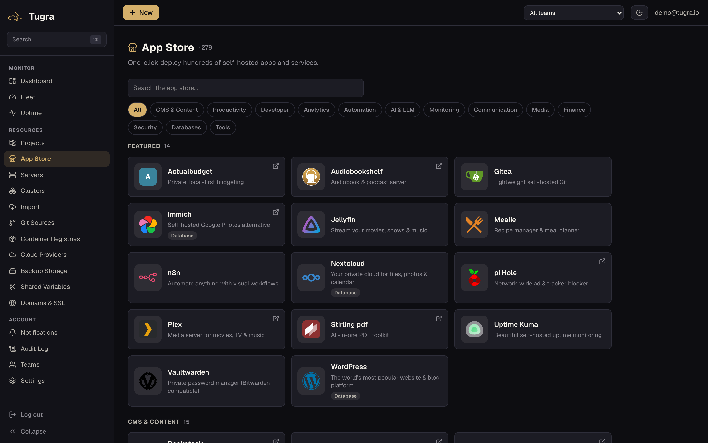
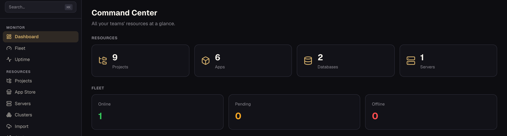
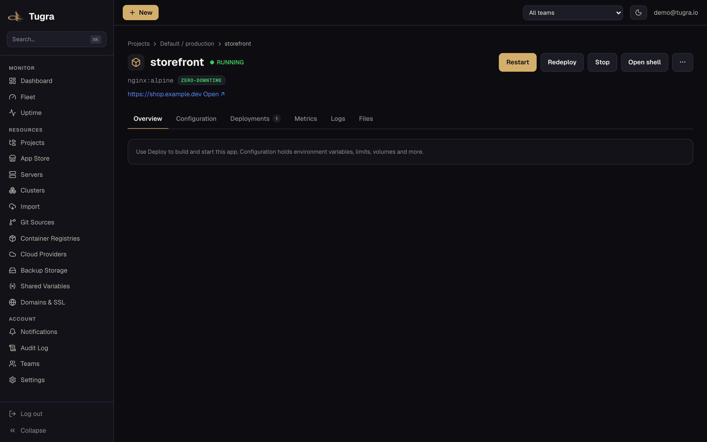
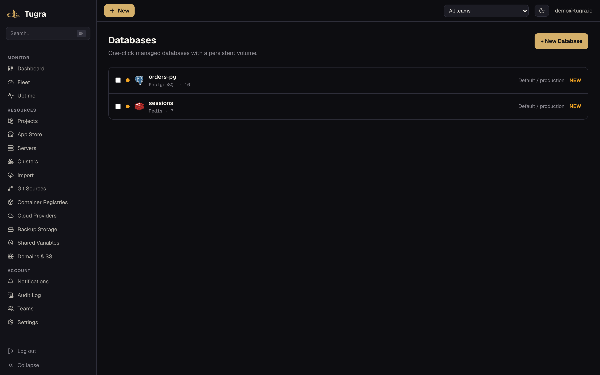
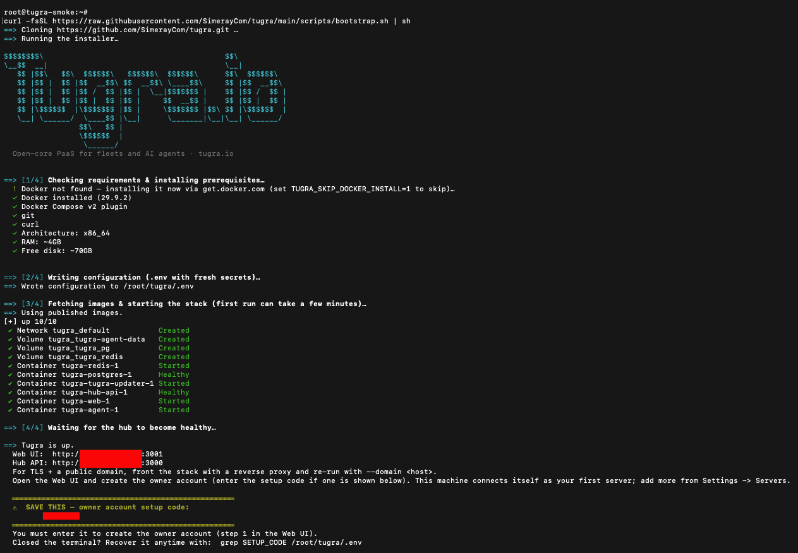

<div align="center">


# Tugra

*您的印记，盖在每一台服务器上。*

**为服务器机群与 AI 智能体而生、可自托管的开源核心（open-core）PaaS。**

[](https://github.com/SimerayCom/tugra/stargazers)
[](LICENSE)
[](https://github.com/SimerayCom/tugra/releases)
[](https://github.com/SimerayCom/tugra/actions/workflows/ci.yml)
[](#快速开始)

[官网](https://tugra.io) · [文档](docs/README.md) · [发布流程](docs/RELEASING.md) · [路线图](#路线图)

[ English](README.md) · [ Türkçe](README.tr.md) · [ Español](README.es.md) · [ Deutsch](README.de.md) · [ Français](README.fr.md) · [ Português](README.pt.md) ·  **简体中文** · [ 日本語](README.ja.md)

</div>

---

> 欢迎提交 issue 和反馈。可以尝试哪些功能以及如何反馈问题，请参阅[测试指南](docs/beta-testing.md)。

<div align="center">





&nbsp;

</div>

## 默认原生支持智能体

Tugra 内置原生 [MCP](https://modelcontextprotocol.io) 服务器——让 Claude、Cursor 或您自己的智能体直接接入您的基础设施，进行查看、部署、扩缩容和运维，所用的个人访问令牌、权限范围和审计记录与 REST API 完全一致。无需额外的集成包，也绝不会向模型返回任何密钥值。

```bash
# List every tool the server exposes
curl -s https://your-tugra-host/api/v1/mcp \
  -H "Authorization: Bearer $TUGRA_PAT" \
  -H "Content-Type: application/json" \
  -d '{"jsonrpc":"2.0","id":1,"method":"tools/list"}'

# Ask it something real: what's actually deployed right now?
curl -s https://your-tugra-host/api/v1/mcp \
  -H "Authorization: Bearer $TUGRA_PAT" \
  -H "Content-Type: application/json" \
  -d '{"jsonrpc":"2.0","id":2,"method":"tools/call","params":{"name":"list_applications","arguments":{}}}'
```

这与底层 REST API 是同一个 `POST /api/v1/mcp` 端点，使用相同的个人访问令牌认证、scope 和 IP 白名单——无需管理单独的凭据，解密后的密钥值也绝不会返回给模型。目录共有 **82 个工具**：45 个只读工具（包括一次调用即可返回全机群状态、健康度、应用列表的汇总，以及沙箱化的卷文件浏览器），另有 37 个受 PAT scope 约束的变更/运维工具（部署 · 取消排队中的部署 · 重启 · 在线扩缩容 · 回滚 · 设置 env · 重启服务器（需输入确认，事后验证）· 在云服务商侧开关云服务器，即使其 agent 离线也可操作（需输入确认）· 组建/扩展 swarm · 针对整个集群的全机群操作 · 一键配置域名 DNS · 有引导的迁移运行，默认 dry-run）。每个变更工具都复用 REST API 完全相同的团队权限检查和审计记录，不可逆操作（解散 swarm、删除应用）还需要明确输入名称确认。面向第三方客户端的 OAuth 仍在路线图上。

## 什么是 Tugra？

Tugra 是一个可自托管的开源核心（open-core）控制平面，用于在您自己的服务器上部署、监控和运维应用与数据库——提供 Heroku、Render 或 Railway 那样的日常使用体验，却不必把基础设施交给别人的云。它的重心是**服务器机群（fleet）**：跨多台服务器的真正 Docker Swarm 集群（而不是一次只管一台机器）、覆盖整个机群的批量操作，以及面向 AI 驱动运维的内置 MCP 服务器——这一切都基于一份您真正能够阅读的许可证。

## 为什么选择 Tugra

- **机群优先，而非单机**——把服务器编组成集群，在其上组建真正的 Docker Swarm，只需一次批量操作调用就能对整个机群执行命令，不必再逐台 SSH 登录。
- **同样原生支持智能体**——内置 MCP 服务器通过 `POST /api/v1/mcp` 提供 82 个工具（只读 + 受 PAT 权限范围约束的变更 / 机群运维操作），权限范围由与 REST API 相同的个人访问令牌控制。
- **9 种数据库引擎，同一套工作流**——PostgreSQL、MySQL、MariaDB、MongoDB、Redis、KeyDB、Dragonfly、ClickHouse 和 LibSQL，创建方式完全一致；其中八种内置基于逻辑 dump 的备份与恢复（LibSQL 没有 dump 工具，仅由文件级卷备份覆盖——为获得一致的副本，请先停止应用）。
- **真正的 TLS，真正的通配符**——通过 Traefik 为每个应用自动签发 Let's Encrypt 证书，并为集群 / Swarm ingress 提供 DNS-01 通配符证书（`*.yourdomain.com`），而不只是单域名的 HTTP-01。
- **异地备份**——定时 dump 到本地磁盘或兼容 S3 的存储（S3/R2/MinIO），可选加密（gpg AES-256）保存，一键恢复；定时的**恢复验证演练**可证明备份确实能够恢复，PostgreSQL 还支持**时间点恢复**（WAL 传输 + 基础备份，可在面板中恢复到任意一秒）。
- **值得信赖的部署**——带健康检查关卡的滚动部署，关卡失败时自动回滚（外加可选启用、切换后会自动回退的 soak 观察期）；机群滚动发布（金丝雀 → 分批 → 暂停/回滚）；绝不会写入镜像的构建密钥；以及能在控制平面重启后继续完成的部署。
- **从面板里离开 Coolify** — 先添加运行 Coolify 的服务器，然后依次进入 **Import > Coolify > Connect through the agent**。Tugra 通过 Agent 读取 Coolify 自己的数据库（无需 API 令牌），按证据把 Coolify 的服务器与你的服务器配对，并就地接管每台服务器，沿用 Coolify 已构建的镜像和已在使用的卷。之后清理 Coolify 留下的内容（绝不动数据卷），带回滚地在服务器之间迁移整个项目，最后关闭 Coolify。在清理之前，“Give back to Coolify”可以一键撤销接管。详见 [Move off Coolify](docs/move-off-coolify.md)。
- **真正的开源核心，不搞“开源洗白”**——以上所有功能都在*本*仓库中以 AGPL-3.0 免费提供。Pro/Cloud 功能（SSO、审计日志导出、白标）通过单独授权的签名密钥解锁——这里不会催您升级，也不会暗中限制您能做的事。Tugra 会发送匿名使用统计，默认开启：仅包含汇总计数（服务器、应用、数据库、部署、团队、用户、集群、监控的数量）以及您的版本、发布通道、版本类型（edition）、操作系统、CPU 架构和 Node.js 主版本，以随机 ID 标识；不含名称、IP、域名或密钥，接收端也不会存储您的 IP。您可以随时通过 `--no-stats` / `TUGRA_STATS=0` 或在 Settings 中关闭。更新检查同样默认开启：每小时获取一次已签名的约 2 KB 清单，不含任何标识符；可通过 `--no-update-checks` / `TUGRA_UPDATE_CHECKS=0` 关闭。公网 IP 检测仍需手动开启。

## Tugra 与同类产品对比

下表将 Tugra 与大家在选型时真正会评估的可自托管 PaaS 工具逐项对比（竞品数据核对于 2026-11）。`✅` 内置 · `~` 部分支持 / 有限制 · `—` 没有文档记载的内置对应功能 · `🔜` 在 Tugra 路线图中。发现错误？[提交 issue](https://github.com/SimerayCom/tugra/issues)。

| | **Tugra** | Coolify | Dokploy | Portainer | CapRover | Dokku |
|---|---|---|---|---|---|---|
| **部署与构建** | | | | | | |
| Web UI 控制台 | ✅ | ✅ | ✅ | ✅ | ✅ | — |
| 从 Git 部署 | ✅ | ✅ | ✅ | ~ | ~ | ✅ |
| Docker Compose 部署 | ✅ | ✅ | ✅ | ✅ | ~ | ~ |
| 预览部署（PR 应用） | ✅¹¹ | ✅ | ✅ | — | — | ~ |
| 回滚 | ✅ | ✅ | ✅ | ~¹² | ✅ | ~ |
| 应用商店 / 一键模板 | ✅ | ✅ | ✅ | ✅ | ✅ | — |
| **数据** | | | | | | |
| 托管数据库引擎 | **9** | 9 (SQLite 为实验性)¹² | 6 | — | — | ~¹² |
| 定时 S3 备份 + 恢复 | ✅ | ✅ | ✅ | — | — | ~ |
| 应用 Docker 卷备份（文件级，非快照） | ✅ | ~¹² | ✅ | — | — | — |
| **域名与 TLS** | | | | | | |
| 自定义域名 + 自动 SSL | ✅ | ✅ | ✅ | — | ✅ | ✅ |
| DNS-01 通配符证书 | ✅ | ~ | — | — | ~¹² | ~ |
| **机群与高可用** | | | | | | |
| 多节点集群 | ✅ Swarm | 逐台独立管理¹ | ✅ Swarm | ✅ | ✅ | ~ k3s⁶ |
| 多 Manager 节点 Raft 高可用 + ingress 高可用 | ✅ | — | — | — | — | — |
| 全机群批量操作（一次调用） | ✅ | — | — | — | — | — |
| 操作系统补丁管理（单台服务器 + 整个机群） | ✅ | ~¹² | — | — | — | — |
| 时间点恢复（PostgreSQL WAL） | ✅¹⁰ | — | — | — | — | — |
| 定时恢复验证演练 | ✅ | — | — | — | — | — |
| 机群滚动发布（金丝雀 → 分批 → 自动暂停/回滚） | ✅ | — | — | ~¹² | — | — |
| 切换后自动回滚（soak 观察窗口，按应用选择启用） | ✅ | — | ~¹² | — | — | — |
| **可观测性** | | | | | | |
| 内置指标（CPU/内存/磁盘） | ✅ | ~ | ✅ | ~ | ~¹² | — |
| 可用性监控 + 通知 | ✅ | ~ | ~¹² | — | — | — |
| 应用 / 容器日志查看器 | ✅ | ✅ | ✅ | ✅ | ✅ | ✅ |
| **访问控制与智能体** | | | | | | |
| 团队 / RBAC | ✅ | ✅ | ✅ | ~⁷ | — | — |
| SSO / OIDC | ✅ (Pro)⁸ | ✅ | ✅ | ~⁷ | — | — |
| 审计日志 | ✅ | ✅ | ✅ | ~⁷ | — | — |
| MCP / 智能体控制 | ✅ 82 tools⁵ | ✅ | ✅ | ~⁷ | — | ~² |
| **信任与许可证** | | | | | | |
| 遥测 | 匿名，可关闭（仅计数） | n/a | n/a | n/a | n/a | n/a |
| 迁入（从 Coolify 导入） | ✅⁹ | — | — | — | — | — |
| 核心许可证 | AGPL-3.0 | Apache-2.0 | Apache-2.0³ | zlib + BE⁷ | Apache-2.0 + 条款⁴ | MIT |

<sub>¹ Coolify v4 逐台单独管理服务器（没有内置集群功能）；其 Docker Swarm 支持已弃用（计划在 v5 中移除），要把同一镜像部署到多台服务器需要自备负载均衡器。 ² 一个由第三方开发、尚处早期阶段的 Dokku MCP 项目，并非官方发布。 ³ Dokploy 的核心是 Apache-2.0；另有一份 Source-Available 许可证覆盖其企业版 `proprietary/` 目录（SSO、审计日志、白标）——与 Tugra 采用的开源核心模式如出一辙。 ⁴ CapRover 的 `LICENSE` 为 Apache-2.0，并附有一份附录，限制对付费功能的修改和再分发。 ⁵ Tugra、Coolify 和 Dokploy 都提供带读写工具的 MCP 服务器。Tugra 额外提供全机群操作（一次调用覆盖整个集群）、对破坏性工具的名称确认，以及密钥脱敏。 ⁶ Dokku 不支持 Docker Swarm；它的多节点方案是 `scheduler-k3s` 插件（k3s/Kubernetes），属于另一种架构。 ⁷ Portainer 完整的 RBAC、AD/OIDC SSO 模板和审计日志属于 Business Edition（最多 3 个节点免费）；Community 版只有基础用户和有限的 LDAP/OAuth。其官方 MCP 服务器仓库不受支持；受支持的 AI 方案（Portainer Command）属于 Business Edition。 ⁸ Tugra 的核心免费且功能完整（团队/RBAC、审计日志、备份、监控、MCP、迁移工具、多节点高可用）；SSO/OIDC 是 Pro 功能。 ⁹ 通过 Coolify 所在服务器上的 Tugra Agent（无需 API 令牌）或 Coolify API 读取 Coolify，然后就地接管每台服务器，或把它复制到另一台服务器；另有一个本地 Docker 接管工具，可就地接管同一主机上的容器（保留其具名卷）。Postgres、MySQL、MariaDB、MongoDB、ClickHouse、Redis、KeyDB 和 Dragonfly 的数据库**数据**可通过在 Coolify 主机上粘贴运行的一条命令跨主机迁移，应用**卷**数据通过迁移工具的流式、可断点续传卷复制迁移，LibSQL 通过 `tar`/`rsync` 迁移（[docs/move-off-coolify.md](docs/move-off-coolify.md)、[docs/coolify-migration.md](docs/coolify-migration.md)）。¹⁰ 仅限 PostgreSQL；其他引擎仍保留定时的逻辑 dump。 ¹¹ 来自 GitHub、GitLab、Gitea/Forgejo 和 Bitbucket（Cloud 与 Server）的 pull/merge request 事件会创建、更新和删除预览；预览需要由 Git 构建且已启用预览的应用，来自 fork 的 pull request 会被忽略。 ¹² 竞品说明取自官方文档，2026-11：Coolify 的 Server Patching 按服务器进行且为 Beta，其存储备份没有 UI 恢复功能，并且文档中列出 9 种数据库引擎，但定时备份只覆盖 6 种；Dokploy 的监控阈值标注为仅限 Cloud，其回滚是需要您自行配置的 Docker Swarm 原生更新回滚；Portainer 的金丝雀式分组发布属于 Business Edition，且仅适用于 Edge Stacks；CapRover 的 DNS-01 和 Netdata 监控需要手动/自行选择启用；Dokku 的数据库引擎是官方 CLI 插件，没有 UI。 产品名称均为其各自所有者的商标；Tugra 与它们没有任何隶属关系，也未获其背书。</sub>

## 快速开始

在全新的 Linux 主机上，**一条命令**即可安装前置依赖（git、Docker）、克隆仓库并启动整套服务。不需要域名，不需要 Cloudflare 令牌，也不需要其他配置——面板会出现在 `http://<server-ip>/`（80 端口，由 Tugra 自带的代理提供服务，因此只需开放 80/443 端口）：

```bash
curl -fsSL https://tugra.io/install | sh
```

然后打开打印出的 URL，创建 owner 账号；有域名后，在 **Settings → Instance → Panel domain** 中设置（Let's Encrypt 免费 HTTPS，无需令牌，在 Cloudflare 橙色云后面也能用）。想从第一分钟就用上域名，就先把域名的 DNS 指向服务器，再把它加到同一条命令里：

```bash
curl -fsSL https://tugra.io/install | sh -s -- --domain panel.example.com
```

<p align="center"></p>

想先看一眼再运行（对任何会获得近乎 root 级 Docker 访问权限的脚本，这都是明智之举）？可以自己克隆仓库并运行安装脚本——它只会写入本地 `.env` 并调用 `docker compose`，缺少 Docker 时会自动安装，而且是幂等的（可放心重复运行）：

```bash
git clone https://github.com/SimerayCom/tugra.git
cd tugra
less scripts/install.sh   # review it first
./scripts/install.sh
```

安装脚本会生成高强度的密钥并写入本地 `.env`（重复运行会保留这些密钥），然后通过 `docker compose` 启动 hub、Web UI、PostgreSQL 和 Redis。完成后，打开终端输出的 **Web UI** 地址（`http://<host-ip>/`，使用 `--domain` 时为 `https://<your-domain>`），创建第一个账号——它将成为该实例的**所有者**。全新安装时，安装脚本还会输出一个一次性的**设置码**，创建该账号时需要输入（可通过 `grep SETUP_CODE .env` 找回）。接着按照引导向导连接您的第一台服务器。

重新运行 `./scripts/install.sh`（例如在 `git pull` 之后）是安全的——它会保留您的密钥，只更新配置，因此也可以直接当作升级方式。

**生产环境（TLS + 域名）。** `--domain` 会让 Tugra 自带的代理通过 HTTPS 提供面板，并自动申请 Let's Encrypt 证书（HTTP-01；不需要邮箱，也不需要 Cloudflare 令牌）。请先把域名的 DNS 指向服务器。也可以不加这个参数，之后在 **Settings → Instance → Panel domain** 中设置域名：证书签发前旧地址继续可用，签发失败则自动回滚。如果想让 Tugra 放在你**自己的**反向代理后面，请使用 `--no-auto-tls`（当 :80/:443 已被其他服务占用时也会自动选用），并按下面的方式路由：

```bash
./scripts/install.sh --domain tugra.example.com --no-auto-tls
```

把绝大部分流量路由到 **web**（`:3001`）——它会替您把 REST API 和 OAuth 起始请求代理给 hub——只将 web 处理不了的路径转发到 **hub**（`:3000`）：

| 路径前缀 | → |
|---|---|
| `/agent`、`/terminal`（WebSocket）、`/install`、`/webhooks`、`/auth/oauth` | hub `:3000` |
| 其余所有路径（`/`、`/api/*`） | web `:3001` |

注意事项：

- **TLS：** 使用 `--domain` 时默认自动签发（内置 Traefik + Let's Encrypt；`--acme-email you@domain` 是用于接收到期通知的可选联系邮箱），也可以用 `--no-auto-tls` 接入自己的反向代理（Caddy、Traefik、nginx 等）。在 Cloudflare 橙色云后面无需令牌即可工作；如果第一张证书没有签发，把 SSL/TLS 模式设为 **Full**，并先关闭 **Always Use HTTPS**，直到签发成功（通过 `--acme-dns-cloudflare-file` 使用 DNS-01 令牌是可选的替代方案）。`--domain` 会设置 `COOKIE_SECURE=true` + `HUB_TRUSTED_PROXY=true`。
- **经典双端口快速开始。** `--raw-ports` 保留旧布局（没有代理；web `:3001`，hub `:3000`）；在这次改动之前完成的安装会继续沿用它，80 端口已被占用的主机也会得到这种布局。
- **锁定原始端口。** 当 `HUB_TRUSTED_PROXY=true` 时，hub 会信任 `X-Forwarded-For`（仅限来自私有 / 回环 / docker 对端，或 `HUB_TRUSTED_PROXY_CIDRS` 所列地址），原始的 `:3000`/`:3001` 端口应当**只**对代理开放。全新的 `--domain` 安装会把它们绑定到 `127.0.0.1`（同主机代理），已有安装在切换为 https 时也会被迁移到这种绑定（`--keep-raw-ports` 可选择不迁移）。如果代理运行在另一台主机上，请把 `HUB_BIND`/`WEB_BIND` 设置为本机内网网卡的 IP，并用防火墙限制这些端口——Docker 映射的端口会绕过 `ufw`。
- **“Sign in with GitHub”** 仅在这种单一 origin 的代理部署下可用（hub 与 web 共用同一个公网 origin，会话 cookie 才能被 SPA 读取）；在普通的双端口快速开始模式下不可用。

> 已发布的镜像（`ghcr.io/simeraycom/tugra-*`）会被自动拉取；在没有对应架构已发布镜像的主机上，安装脚本会基于您本地检出的代码构建——命令相同，无需任何改动。每个发布版本都固定到 digest，并附带签名的构建来源证明（provenance）；参见 [docs/upgrade.md](docs/upgrade.md)。

**MCP 快速开始。** Tugra 启动后，创建一个个人访问令牌（**Settings → API tokens**），然后让任意 MCP 客户端指向它：

```bash
curl -s http://<web-url>/api/v1/mcp \
  -H "Authorization: Bearer $TUGRA_PAT" -H "Content-Type: application/json" \
  -d '{"jsonrpc":"2.0","id":1,"method":"initialize"}'
```

## 自托管与云端

上文[为什么选择 Tugra](#为什么选择-tugra)中的所有功能都**永久免费且开源**，采用 AGPL-3.0 许可证，自托管在您自己的服务器上——没有人为设置的上限，也没有等着花钱解锁的功能开关。本仓库中的社区版（Community edition）就是真正的产品，而不是阉割过的演示版。

Pro 和 Cloud 版本（SSO、审计日志导出、白标、托管控制平面）以单独的商业许可证提供。如果您需要非 AGPL 的许可证，或有社区版无法满足的需求，请联系 **license@tugra.io**。

## 架构

| 组件 | 技术栈 |
|---|---|
| Hub（API + 控制中枢） | NestJS · PostgreSQL (Prisma) · Redis / BullMQ |
| Web | Next.js |
| Agent | Go（单个二进制文件，每台服务器部署一个） |
| 代理 | Traefik（自动 SSL，含 DNS-01 通配符） |

实时日志、指标和终端均通过 WebSocket 推送。完整说明见 [docs/architecture.md](docs/architecture.md)。

## 路线图

**已发布**(截至 v0.1.0-beta.33)

- [x] Hub ↔ Agent 协议 + 服务器接入（主动外连 WSS · ed25519 · 签名命令 + 能力范围限定）
- [x] 从 Git / Docker Compose / 镜像部署（Nixpacks · Railpack · Heroku buildpack · Dockerfile · 静态站点）
- [x] 反向代理 + 自动 SSL（Traefik · Let's Encrypt，含 DNS-01 通配符）
- [x] 实时指标、构建日志与 Web 终端（WebSocket 流；终端受 capability 控制，默认关闭）
- [x] 数据库（9 种引擎），支持备份与恢复（本地 + S3/R2 异地）
- [x] 多服务器集群 + Docker Swarm 组建，跨整个机群批量操作
- [x] 原生 MCP 服务器——82 个工具（只读 + 受 PAT 权限范围约束的变更 / 机群运维操作）+ 引导式提示词
- [x] 应用商店——280+ 个一键模板 + Home 模式启动器
- [x] 应用卷的文件管理器——浏览、下载、上传、编辑、重命名、修改权限和删除（写入是可选启用的服务器 capability；Web UI，读取另可用 MCP `list_files`）
- [x] 预览部署（每个 pull request 一个）
- [x] 可用性监控（HTTP/TCP/指标）+ 12 个通知渠道（webhook · Telegram · ntfy · Discord · Slack · Gotify · SMTP · Pushover · Teams · Mattermost · Lark · Resend）
- [x] 定时任务（cron）· 回滚 · 资源限制与健康检查
- [x] 项目 / 环境 · 团队、角色与邀请 · 标签 · 共享变量
- [x] 公开 API（OpenAPI）+ CLI（`tugra`）
- [x] 服务器补丁管理（操作系统软件包更新），在主机上以临时 systemd 单元运行，因此 Docker/containerd 升级不会把更新中途打断；Ubuntu 的分阶段（phased）更新单独列出 · 与 Coolify 一致的 Docker 清理（每天一次，另外在服务器磁盘超过阈值时也会运行；服务器页面会显示它删除什么、绝不删除什么）
- [x] 在面板中重启服务器（立即，或最多提前 7 天预约），带影响预览，重启后自动检查 Docker、此前运行的每个容器、每个已路由的域名以及需要重启的标志是否都已恢复；仅限手动，也可通过 CLI 和 MCP 使用
- [x] 自更新（签名发布）+ 引导式上手
- [x] 迁移工具——接管本地 Docker 容器 + 从 Coolify（Web 向导，通过 Tugra Agent 或 API）和 Dokploy（Web 向导 / API / MCP / CLI）导入（连接 · 规划 · 应用 · 回滚）+ 一条命令的跨主机数据库数据迁移（Postgres · MySQL · MariaDB · Redis · KeyDB · Dragonfly）+ 流式、可断点续传的应用卷复制 + 有引导、可恢复的迁移运行（`tugra import run` 与 `migration_run_*` MCP 工具：先 dry-run，输入式确认，可中止/回退），以及面向大型数据库的流式转储通道（Postgres · MySQL · MariaDB）——已对照 Coolify 4.1.2 与 4.7.5 检查（API 速率限制、带时间戳的容器名、`read:sensitive` 令牌）
- [x] Move off Coolify——通过其服务器上的 Agent 读取 Coolify，按证据匹配其服务器，就地接管每一台（镜像与卷原样沿用，可一键交还），清理残留，带回滚地在服务器之间迁移整个项目，每个团队一个迁移批次；见 [docs/move-off-coolify.md](docs/move-off-coolify.md)
- [x] 恢复验证演练（定时执行，带存活看门狗）· PostgreSQL 时间点恢复（WAL 传输 · 基础备份 · 恢复到任意一秒）
- [x] 带健康检查关卡的滚动部署 + 可选启用的切换后 soak 观察与自动回退 · 机群滚动发布（金丝雀 → 分批 → 健康检查关卡 → 暂停/恢复/回滚）
- [x] 部署可在 hub 重启后继续完成（agent 命令日志 + 结果接管）· 单次部署详情页（时间线 · 实时日志 · 配置对比）
- [x] 通过 BuildKit `--secret` 传递构建密钥（Dockerfile 构建） · 主密钥轮换（可恢复的重新加密任务，无需重新输入任何内容，应用不受影响；hub 会重启两次） · 固定到 digest 的签名自更新，并在更新前创建恢复点
- [x] 云服务器供应（Hetzner · DigitalOcean · Vultr）· Cloudflare Tunnel · 内置流量分析（本地 GeoIP，不回传数据）· [日志转发（log drains）](docs/log-drains.md)· 私有 registry · Vault 密钥提供方（Pro）

**下一步**

- [ ] 面向第三方客户端的 MCP OAuth（动态客户端注册、PKCE）
- [ ] 更多迁移来源（CapRover）
- [ ] 移动应用

## 社区与文档

- [完整文档](docs/README.md)——安装、架构、API、CLI、安全、开源核心模式
- [Issues](https://github.com/SimerayCom/tugra/issues)——缺陷报告与功能请求
- [Discussions](https://github.com/SimerayCom/tugra/discussions)——提问、交流想法、成果展示
- [贡献指南](CONTRIBUTING.md) · [行为准则](CODE_OF_CONDUCT.md) · [CLA](CLA.md)
- [安全政策](SECURITY.md)

## 贡献者

<a href="https://github.com/SimerayCom/tugra/graphs/contributors">
  
</a>

## 赞助者

Tugra 公开开发、公开维护。如果它对您或您的团队有帮助，欢迎[在 GitHub 上赞助本项目](https://github.com/sponsors/mrcandev)——目前还没有赞助者等级，您将成为第一位赞助者，每一份支持都有助于项目保持独立发展。

## Star 历史

[](https://star-history.com/#SimerayCom/tugra&Date)

## 许可证

Tugra 采用**开源核心（open-core）**模式：

- **核心**（本仓库）——[GNU AGPLv3](LICENSE)。可自由使用、自托管、研究和修改。如果您将修改后的版本作为网络服务运行，则必须以相同许可证共享您的修改。
- **Agent 与 CLI**——[MIT](agent/LICENSE)。可在任何场景下使用，不附带任何条件。
- **Tugra Cloud 与 Pro 功能**——专有软件，暂未公开发布（参见[自托管与云端](#自托管与云端)）。

**商业许可证：** 如果您无法遵守 AGPLv3（例如想在 Tugra 之上构建闭源产品或 SaaS 服务），我们提供商业许可证。请联系 **license@tugra.io**。完整说明见 [docs/open-core.md](docs/open-core.md)。

---

<div align="center"><sub>AGPL-3.0 © Simeray Ltd——参见 <a href="LICENSE">LICENSE</a>。</sub></div>
